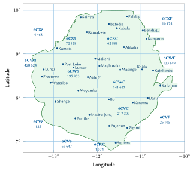
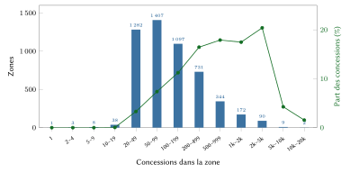
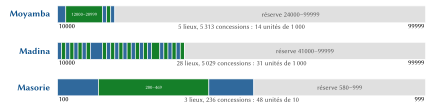
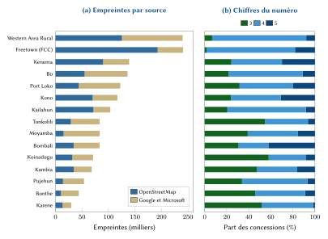
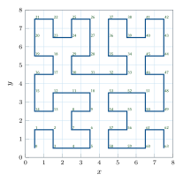

# Introduction

Une adresse remplit trois fonctions. Elle permet à une personne de dire où elle habite sous une forme dont un tiers peut se servir ; elle donne à une institution une référence stable vers un lieu ; et elle permet à un visiteur, à un livreur ou à une équipe d’ambulance de trouver la porte. En Sierra Leone, aucun système national ne remplit ces fonctions. La fiche d’adressage de l’Union postale universelle pour le pays ne mentionne aucun code postal [@upu2002], Sierra Leone Postal Services (SALPOST) ne publie aucune liste de codes, et les noms de rue accompagnés de numéros n’existent que dans le centre de Freetown et dans certains quartiers des grandes villes. Ailleurs, on décrit la maison (« Kissy Road, près de la mosquée, puis demander ») et la trouver dépend d’un appel téléphonique et de la connaissance des lieux.

Le pays dispose pourtant d’une pratique d’adressage solide. Après 2020, le conseil municipal de Freetown (Freetown City Council, FCC) a reconstitué son registre foncier à partir d’images satellitaires, le faisant passer d’environ 60 000 à plus de 160 000 propriétés, et identifie chaque propriété par son Plus Code, une référence de grille ouverte, parce que « les bâtiments n’ont pas toujours un nom de rue ni un numéro fiables » [@fcc2024; @ataf2023]. Tout modèle national doit respecter cette pratique et lui être compatible.

Cet article décrit un tel modèle et le registre établi avec lui. Nos contributions sont les suivantes :

1. un code que l’on peut dire et retenir, composé d’un nom de lieu déjà en usage et d’un numéro court, et pourtant unique à l’échelle nationale à lui seul, sans district, chefferie ni ville à ajouter (sections 4.1 à 4.8) ;
2. une numérotation locale (des voisins reçoivent des numéros voisins), extensible (les nouvelles maisons et les nouveaux lieux ne renumérotent jamais l’existant) et vérifiable (un chiffre de contrôle détecte toute erreur sur un chiffre et toute inversion de deux chiffres voisins, y compris les fautes qui tomberaient dans un autre lieu du même nom) (sections 4.6 à 4.9) ;
3. une compatibilité complète avec les adresses Plus Code du FCC, affichées en premier dans le ressort du conseil (sections 4.10 et 4.13) ;
4. un registre complet et ouvert de 1 359 282 codes, un moteur de référence et un serveur déployable qui reproduit les réponses de l’émetteur national (section 5) ;
5. une évaluation mesurée et un ensemble d’estimations explicites des effets pour les citoyens, le commerce, les services d’urgence et l’administration (sections 6 à 11).

La section 2 passe en revue les systèmes existants du pays et la littérature internationale. La section 3 décrit les données. La section 4 expose le modèle, avec chaque formule et un exemple traité sur un code réel. La section 5 présente la mise en œuvre et la section 6 son évaluation. La section 7 rend compte des conceptions envisagées puis écartées. Les sections 8 à 11 estiment les bénéfices par secteur. La section 12 traite de la vie privée, de la sécurité et de la gouvernance, la section 13 des limites, et la section 14 conclut.

# Contexte et travaux antérieurs

## Adressage, poste et foncier en Sierra Leone

La Sierra Leone couvre environ 71 740 km² sur la côte atlantique de l’Afrique de l’Ouest. Les résultats provisoires du recensement de mi-période de la population et de l’habitat de 2021 ont dénombré 7 541 641 habitants, un chiffre publiquement contesté [@statssl2021]. L’anglais est la langue officielle et le krio la langue que presque tout le monde partage ; le mendé domine au sud et à l’est, le temné au nord et à l’ouest, aux côtés du limba, du kono, du kissi, du peul, du soussou et d’autres langues. Les chiffres s’écrivent de la même façon quelle que soit la langue parlée, et les nombres se disent couramment en krio ou en anglais.

**Pas de codes postaux.** La fiche de l’UPU, datée de 07/2002, donne l’exemple `Mr. John Kamara, 7A Ross Road Cline, FREETOWN`, sans code postal [@upu2002]. Nous n’avons trouvé, jusqu’en octobre 2026, aucune annonce de codes postaux ni d’un système national d’adresses de la part de SALPOST, du ministère de la Communication, de la Technologie et de l’Innovation ou de l’Autorité nationale de l’état civil (le relevé figure dans `docs/existing-systems.md`).

**Les Plus Codes de Freetown.** Le FCC décrit le Plus Code comme « un code unique de onze caractères qui fait office de code postal et d’adresse », et indique pour ses propres bureaux, au 17 Wallace Johnson Street, le code `FQR7+HX` [@fcc2024]. L’évaluation foncière par points expérimentée dans la ville en 2019 reposait précisément sur ce type d’identification des propriétés [@grieco2019]. Le registre du FCC n’est pas public : c’est un registre fiscal, dont les propriétaires, les valeurs locatives et les paiements sont confidentiels.

**Des limites mouvantes.** La réorganisation de 2017 a créé la province du Nord-Ouest et les districts de Falaba et de Karene, et porté le nombre de chefferies de 149 à 190 [@africareview2017]. En 2025, le ministre de l’Administration locale a annoncé l’approbation par le Conseil des ministres de deux nouveaux districts, Bandajuma et Kpanguma, ainsi que de nouveaux conseils pour Freetown et pour le district rural de la Western Area [@sierraloaded2025]. Un code fondé sur une unité administrative aurait donc changé deux fois en dix ans.

**Recensement et foncier.** Le recensement général de la population et de l’habitat de 2026 doit commencer le 2 décembre 2026 [@statssl2026] ; il produira des zones de dénombrement, non des adresses. La loi de 2022 sur la Commission foncière nationale crée un département de la cartographie de l’index cadastral, et la loi de 2022 sur les droits fonciers coutumiers régit l’enregistrement et la délimitation des terres coutumières [@nlc2022; @clra2022]. Les plans de bornage utilisent le système géodésique Sierra Leone 1968 projeté dans les fuseaux UTM 28N et 29N [@epsg2161]. Une adresse n’est pas un titre foncier, et le modèle maintient cette distinction.

## Pratique internationale

La norme S42 de l’UPU définit les éléments des adresses postales et des gabarits pour les présenter [@upuS42], et la norme ISO 19160-1 propose un modèle conceptuel de l’information d’adresse, cycle de vie et alias compris [@iso19160]. Toutes deux décrivent la structure des adresses une fois qu’elles existent ; aucune ne dit comment les créer là où elles manquent. Le livre blanc de l’UPU sur l’adressage soutient que l’adresse est un bien public et une condition préalable des services postaux, financiers et civiques [@upu2012].

Les données les plus systématiques sur la création d’adresses dans les villes africaines proviennent de la revue, par la Banque mondiale, des programmes d’adressage menés entre 1989 et 2004 dans 52 villes de 15 pays [@farvacque2005]. Dans un échantillon de 21 villes ayant achevé le travail, 1,2 million de portes ont été adressées pour un coût moyen de 5,7 dollars US par porte, et avant ces programmes 8 % seulement des rues portaient un nom. La revue souligne aussi qu’un répertoire d’adresses sert bien au-delà de la poste, par exemple pour rapprocher les rôles fiscaux, et avertit que, faute d’entretien, un système d’adresses devient vite obsolète, surtout dans une ville en croissance. Cet avertissement fonde deux de nos choix : partir des noms que les habitants emploient déjà, et rendre le registre extensible sans jamais le renuméroter.

## Codes de grille : pourquoi aucun ne suffit seul

L’Open Location Code (Plus Codes) divise le globe en une grille hiérarchique de cellules en base 20 [@olc]. Un code de dix caractères désigne une cellule d’environ 14 m sur 14 m, et peut être abrégé par rapport à une ville de référence proche. Il est ouvert, fonctionne hors ligne et le FCC l’utilise déjà. Ses défauts comme adresse de logement sont qu’il mêle des lettres et un « + », qu’on le recopie plutôt qu’on ne le retient, et que dans un quartier dense une même cellule peut contenir plusieurs logements (la section 6 mesure la fréquence de ce cas).

Des adresses nationales fondées sur une grille ont été adoptées dans la région. Le système ghanéen d’adresses numériques des propriétés, lancé en 2017, attribue des codes à des cellules d’environ 5 m sur 5 m [@citifm2017]. Ces dispositifs donnent un code à chaque point mais, comme les Plus Codes, ce code n’est pas une expression que les gens emploient déjà.

Les identifiants nationaux purement numériques se composent facilement mais ne signifient rien ; les codes fondés sur les districts se disent facilement mais sont invalidés par chaque redécoupage. La section 7 confronte ces options aux données sierra-léonaises.

## Exigences

De cette revue nous avons tiré dix exigences, par ordre de priorité :

1. **Retenu sans effort** : un nom de lieu déjà en usage et un numéro court dit par groupes, obtenu d’un seul geste.
2. **Unique à l’échelle nationale à lui seul** : ni district, ni chefferie, ni ville, ni position du téléphone.
3. **La concession et son portail** : l’unité est la parcelle ou la cour familiale ; les bâtiments en sont des sous-unités ; la navigation s’arrête au portail.
4. **L’adresse officielle d’abord** : là où l’État adresse déjà une propriété, son adresse est affichée en premier, et tout point s’exprime sur la grille du FCC.
5. **Aucune limite administrative dans le code.**
6. **Fonctionne hors ligne.**
7. **Stable** : un code n’est jamais déplacé ni réutilisé.
8. **Des lieux, jamais des personnes.**
9. **Ouvert et transmissible** à l’État.
10. **Propre à la Sierra Leone** : le modèle et son moteur sont spécifiques au pays.

# Données et sources

Le registre est construit à partir de quatre sources ouvertes (tableau 1). Les empreintes de bâtiments proviennent d’OpenStreetMap [@haklay2008; @geofabrik2026] et, là où OpenStreetMap n’en contient pas, des empreintes issues de l’apprentissage automatique de Google Open Buildings [@sirko2021] et de Microsoft [@microsoft2023], diffusées ensemble par l’Overture Maps Foundation [@overture2026]. Les noms de lieux viennent des nœuds de lieu d’OpenStreetMap ; les contours des districts viennent de geoBoundaries [@runfola2020]. Les murs, clôtures et portails sont tirés d’OpenStreetMap.

| Source | Contenu utilisé | Licence | Nombre |
|:------------|:------------|:-------|--------:|
| OpenStreetMap (extrait du 17 octobre 2026) | contours et attributs des bâtiments | ODbL 1.0 | 831 055 empreintes |
| Google Open Buildings et Microsoft, via Overture | empreintes absentes d’OpenStreetMap | CC BY 4.0 / ODbL | 784 646 empreintes |
| Nœuds de lieu d’OpenStreetMap | noms de villes, bourgs, villages, quartiers, hameaux | ODbL 1.0 | 9 316 lieux |
| Barrières d’OpenStreetMap, données de navigation N-Ways | murs, clôtures et haies fermés ; portails | ODbL 1.0 | 423 enclos, 354 portails |
| geoBoundaries ADM2 | contours des districts, servant d’étiquettes seulement | CC BY 3.0 IGO | |

: Sources de données du registre. {#tbl:sources}

Les empreintes et les nœuds de lieu situés hors de la frontière nationale (13 575 empreintes dans l’extrait) sont écartés, afin qu’aucun logement de l’autre côté de la frontière ne reçoive un code sierra-léonais. Les empreintes issues de l’apprentissage automatique portent un attribut de hauteur, mais celui-ci ne prend que 36 valeurs distinctes entre 3,5 m et 7 m et n’est pas utilisé. La figure 1 montre le pays, les zones de 1° entre lesquelles le registre est réparti et les 31 villes de référence servant aux Plus Codes abrégés ; la figure 4(a) montre la contribution de chaque source par district. OpenStreetMap fournit l’essentiel des empreintes à Freetown, Kailahun, Kenema et Kono, où des projets de cartographie ont été actifs, et les jeux de données automatiques l’essentiel à Moyamba, Bonthe et Pujehun.

{#fig:zones width=78%}

# Le modèle

Cette section définit le modèle pas à pas, dans l’ordre où un code se construit : ses formes écrites, les zones, les noms de plaque et les clés de nom, les plages nationales, la numérotation, le chiffre de contrôle, les codes de point et le regroupement des bâtiments en concessions. Chaque étape est illustrée sur le même code réel, Moyamba 15727.

## Les formes d’un code

Le code d’une concession existe sous un petit nombre de formes écrites (tableau 2). Soit $P$ le nom de plaque de la zone de la concession, $N$ son numéro (trois à cinq chiffres, jamais de zéro initial), $A$ l’indice à cinq chiffres de la zone, $F$ l’identifiant national à quatre chiffres du nom et $g$ la position du portail de la concession. Alors
$$
\text{mémorisée} = P \;\sqcup\; N, \qquad
\text{plaque} = P \;\sqcup\; \gamma(N) \;\cdot\; \sigma(g), \qquad
\text{machine} = \texttt{SL-}A\texttt{-}N,
\tag{1}
$$
où $\sqcup$ désigne une espace, $\gamma$ écrit le numéro par groupes, tel qu’on le prononce ($482$ ; $27\,16$ ; $157\,27$), et $\sigma(g)$ est le Plus Code abrégé du portail (section 4.10). Le chiffre de contrôle $c = \operatorname{Damm}(F \,\|\, N)$ de l’équation (14) est réservé aux systèmes : l’interface le renvoie et le vérifie, mais il n’est jamais imprimé sur une plaque.

| Forme | Exemple | Usage |
|:--------|:-------------|:-------------|
| Mémorisée | **Moyamba 15727**, dite « Moyamba 157 27 » | les personnes : dite, saisie, écrite sur un colis |
| Plaque | **Moyamba 157 27 · 5H68+3V Moyamba** | plaques, autocollants, formulaires, messages partagés |
| Machine | **SL-03663-15727** | applications, codes QR, systèmes partenaires |
| Bâtiment, local | **Moyamba 15727.2**, **Moyamba 15727.2/3** | un bâtiment de la concession ; un logement ou une boutique loués à part |
| Point | **5H68+3V Moyamba**, `6CW95H68+3V` | tout point : son Plus Code |
| Adresse officielle (ressort du FCC) | **FQQ6+9G Freetown** | l’adresse foncière du FCC, affichée en premier |

: Les formes d’un même code. {#tbl:forms}

## Les zones

Une zone est un lieu nommé en usage, figé lors de la première émission, sans rattachement administratif. Son germe est un nœud de lieu d’OpenStreetMap, *primaire* (ville, bourg, faubourg, quartier, village) ou *secondaire* (voisinage, hameau, lieu-dit, habitation isolée). Soient $S_1$ et $S_2$ les germes primaires et secondaires et $d(f,s)$ la distance orthodromique de l’empreinte $f$ au germe $s$. Chaque empreinte est rattachée à
$$
\operatorname{zone}(f) =
\begin{cases}
\arg\min_{s \in S_1} d(f,s) & \text{si } \min_{s \in S_1} d(f,s) \le 4\ \text{km},\\
\arg\min_{s \in S_2} d(f,s) & \text{sinon si } \min_{s \in S_2} d(f,s) \le 15\ \text{km},\\
\arg\min_{s \in S_1} d(f,s) & \text{sinon.}
\end{cases}
\tag{2}
$$

Deux corrections suivent. Une zone primaire dont le nombre estimé de concessions dépasse 4 500 est *scindée* : une empreinte passe au germe secondaire le plus proche dans un rayon de 3 km dont le germe primaire le plus proche est cette zone, si ce germe est plus proche que celui de la zone. Une zone de moins de 20 concessions est *fusionnée* avec la zone du germe primaire le plus proche de son propre germe, dans un rayon de 30 km. L’estimation retient 0,779 concession par empreinte, rapport mesuré à Freetown pendant la conception. Les zones ne franchissent jamais l’estuaire de la Sierra Leone : Lungi et la côte de Bullom gardent leurs propres zones, même là où un germe de Freetown est plus proche par-delà l’eau.

Des 9 316 germes, 5 184 zones contiennent des logements (47 grandes zones ont été scindées et 1 466 petites fusionnées) ; 134 d’entre elles, avec 192 608 concessions, se trouvent dans le ressort du FCC. La zone médiane compte 93 concessions, le 90^e^ centile 604, et la plus grande, Makeni, 10 639 (figure 2).

{#fig:areasizes width=92%}

## Les noms de plaque

Le nom d’un code doit être assez court pour se dire avec un numéro et se peindre sur un portail. Un nom de plaque $s$ est accepté si
$$
\operatorname{ok}(s) \iff \lvert \operatorname{NFC}(s) \rvert \le 12 \;\wedge\; \lvert \operatorname{mots}(s) \setminus L \rvert \le 2 \;\wedge\; s \text{ ne contient aucun chiffre},
\tag{3}
$$
où $L = \{\text{of}, \text{the}, \text{and}, \text{on}, \text{at}\}$ est l’ensemble des mots qui ne comptent pas, et $\lvert\operatorname{NFC}(s)\rvert$ compte les caractères après normalisation Unicode (un trait d’union ou une apostrophe comptent pour un). Un nom trop long suit des étapes fixes : une forme courte documentée que les gens emploient déjà, s’il en existe (aucune n’a encore été documentée pour la Sierra Leone) ; un nettoyage (« Community », « Comm », « Estate », « Area » et le texte entre parenthèses supprimés ; « Town », « Village » et « Ville » supprimés seulement à la fin d’un nom encore trop long, car beaucoup de noms se disent en entier : Allen Town, Congo Town, Murray Town, et Kissy Town n’est pas Kissy) ; un chiffre écrit en toutes lettres (« Badasuma 2 » devient Badasuma Two) ; enfin la suppression d’un mot de repère (Junction, Wharf, Street, Corner, Quarry), de sorte que Gbangbatoke Junction devient **Gbangbatoke**. Rien d’autre n’est coupé automatiquement. Lorsqu’un raccourcissement ferait disparaître un mot de lieu ou un nom de personne, perdrait un qualificatif (Upper Komende, Magbesseh 1 et 2) ou produirait le nom d’un autre lieu ou d’une ville connue (Moyamba Junction n’est pas Moyamba), la zone est soumise à son conseil avec jusqu’à trois propositions (tableau 3).

| Résultat pour les 5 184 zones | Zones |
|:--|--:|
| Nom de plaque identique au nom officiel | 4 890 |
| Nettoyé | 115 |
| Raccourci par suppression d’un mot de repère | 23 |
| Soumis au conseil avec des propositions | 156 |
| dont encore au-delà de la limite | 42 |
| Noms officiels de plus de 12 caractères | 235 |

: Résultats de la règle des noms de plaque. {#tbl:plates}

Les 156 zones soumises portent un nom de plaque provisoire, sous lequel 84 311 codes ont été émis ; un conseil peut modifier ce nom une seule fois, et les numéros ne changent pas. Le nom officiel reste toujours un alias (208 alias, aucun abandonné), de sorte que « Gbangbatoke Junction 1051 » retrouve « Gbangbatoke 1051 ».

## La clé de nom

Deux zones partagent une plage nationale lorsque leurs noms de plaque ont la même *clé* :
$$
\kappa(s) = \operatorname{joindre} \circ \operatorname{replier} \circ \operatorname{ôter}_{\text{the}} \circ \operatorname{découper} \circ \operatorname{ponct} \circ \operatorname{minusc} \circ \operatorname{désaccent}\,(s).
\tag{4}
$$

Les étapes figurent au tableau 4. Les repliements de mots traduisent les graphies krio et anglaise d’un même mot et les manières d’écrire les nombres.

| Étape | Règle | Exemple |
|:-----|:---------------|:---------|
| désaccentuer, minuscules | accents et casse supprimés | FOURAH BAY → fourah bay |
| ponctuation | apostrophes supprimées ; `- _ . , / ( )` deviennent des espaces ; `&` devient « and » | Ma'Sorie → masorie |
| repliement | tong → town, kru → kroo, saint → st, mount → mt, one…ten → 1…10, ii → 2, iii → 3 | Kissy Tong = Kissy Town |
| ôter « the » | un « the » initial supprimé | The Wharf → wharf |
| joindre | mots accolés, mots non alphanumériques supprimés | Gbangba Toke → gbangbatoke |

: Les étapes de la clé de nom, équation (4). {#tbl:key}

Les 5 184 zones portent 3 706 noms de plaque distincts. Parmi eux, 590 sont partagés, par 2 068 zones : Madina par 28 zones, Baoma par 24, Nyandehun et Sembehun par 23 chacun, Moyamba et Looking Town par cinq chacun.

## Une plage nationale par nom

Un nom dont la plage compte $d$ chiffres possède les numéros de $10^{d-1}$ à $10^{d}-1$, que nous découpons en 90 *unités* de
$$
u(d) = 10^{\,d-2}
\tag{5}
$$
numéros chacune : 10 pour trois chiffres, 100 pour quatre et 1 000 pour cinq. Chaque lieu $i$ portant ce nom, avec $n_i$ concessions, reçoit un bloc d’unités entières contenant le double de ses concessions,
$$
k_i(d) = \max\!\left(1, \left\lceil \frac{2\,n_i}{u(d)} \right\rceil\right),
\tag{6}
$$
et le nom prend la plus petite longueur qui laisse au moins neuf unités en réserve :
$$
d^{*} = \min \Big\{ d \in \{3,4,5\} \;:\; \textstyle\sum_i k_i(d) + 9 \le 90 \Big\}.
\tag{7}
$$

Les blocs sont disposés à partir de $10^{d^*-1}$, dans l’ordre des germes des lieux le long de la courbe de Hilbert nationale de la section 4.6 (égalités départagées par l’indice de zone) ; le reste de la plage constitue la réserve du nom. Un bloc plein, ou un nouveau lieu du même nom, prend les unités entières suivantes de la réserve. Quand la réserve est épuisée, le nom ouvre une plage d’un chiffre de plus (des numéros de longueurs différentes ne se confondent jamais), jusqu’à cinq chiffres. Les blocs ne sont jamais déplacés, réduits ni renumérotés.

**Exemple traité : Moyamba.** Cinq lieux portent ce nom, avec 698, 4 313, 241, 35 et 26 concessions. À quatre chiffres (unités de 100), l’équation (6) donne $14 + 87 + 5 + 1 + 1 = 108$ unités, plus que les 81 disponibles ; à cinq chiffres (unités de 1 000), elle donne $2 + 9 + 1 + 1 + 1 = 14$ unités, qui tiennent (tableau 5, figure 3).

| Lieu | District | Concessions | Bloc |
|:--|:--|--:|:--|
| Moyamba | Moyamba | 698 | 10000–11999 |
| Moyamba (la ville) | Moyamba | 4 313 | 12000–20999 |
| Moyamba | Bombali | 241 | 21000–21999 |
| Moyamba | Kenema | 35 | 22000–22999 |
| Moyamba | Kenema | 26 | 23000–23999 |
| réserve | | | 24000–99999 |

: La plage nationale du nom Moyamba. {#tbl:moyamba}

**Exemple traité : Masorie.** Masorie Community, dans le district rural de la Western Area (nom de plaque Masorie, 48 concessions), et deux villages appelés Masorie dans le Tonkolili (134 et 54 concessions) partagent une plage à trois chiffres : 100–199, 200–469 et 470–579. **Masorie 151** et **Masorie 315** sont deux lieux distants de 42 km.

{#fig:ranges width=100%}

Les longueurs obtenues sont résumées au tableau 6 et, par district, à la figure 4(b). La plus grande plage partagée est celle de Kpetema : sept lieux et 11 008 concessions, à cinq chiffres. Aucun nom n’exige plus de cinq chiffres ; aucun n’a donc besoin d’un qualificatif.

{#fig:districts width=86%}

| Chiffres | Noms | Zones | Concessions | Part des concessions |
|:--|--:|--:|--:|--:|
| 3 | 2 945 | 3 387 | 346 381 | 25,5 % |
| 4 | 720 | 1 569 | 788 449 | 58,0 % |
| 5 | 41 | 228 | 224 452 | 16,5 % |

: Longueur du numéro, par nom, par zone et par concession. {#tbl:digits}

## La numérotation dans un lieu : la courbe de Hilbert

Les concessions sont numérotées le long d’une courbe de Hilbert [@hilbert1891] d’ordre 16 tracée sur un cadre national fixe, $\varphi \in [6{,}85^\circ ; 10{,}05^\circ]$ N et $\lambda \in [-13{,}35^\circ ; -10{,}20^\circ]$, évaluée au centre du bâtiment principal de chaque concession. La courbe de Hilbert préserve mieux la proximité que les autres courbes de remplissage usuelles [@moon2001] : des voisins reçoivent des numéros voisins. Les coordonnées de cellule sont
$$
x = \left\lfloor \frac{\lambda + 13{,}35}{3{,}15}\, 2^{16} \right\rfloor, \qquad
y = \left\lfloor \frac{\varphi - 6{,}85}{3{,}20}\, 2^{16} \right\rfloor ,
\tag{8}
$$
et la position $h$ sur la courbe s’accumule sur les bits $s = 2^{15}, 2^{14}, \dots, 1$ :
$$
\begin{aligned}
&r_x = [\,x \wedge s \neq 0\,], \qquad r_y = [\,y \wedge s \neq 0\,], \qquad h \leftarrow h + s^2\,\big((3 r_x) \oplus r_y\big),\\
&(x,y) \leftarrow
\begin{cases}
(s-1-y,\; s-1-x) & \text{si } r_y = 0 \text{ et } r_x = 1,\\
(y,\; x) & \text{si } r_y = 0 \text{ et } r_x = 0,\\
(x,\; y) & \text{si } r_y = 1,
\end{cases}
\end{aligned}
\tag{9}
$$
où $\wedge$ est la conjonction bit à bit, $\oplus$ le ou exclusif et $[\cdot]$ l’indicatrice. La figure 5 montre la courbe d’ordre 3. Les $n$ concessions d’un lieu de bloc $[\ell, u]$, triées selon $(h, \text{identifiant stable})$ et indexées $i = 0, \dots, n-1$, reçoivent
$$
N_i = \ell + i\,\delta + \left\lfloor \frac{\delta}{2} \right\rfloor, \qquad \delta = \left\lfloor \frac{u - \ell + 1}{n} \right\rfloor .
\tag{10}
$$

{#fig:hilbert width=52%}

**Exemple traité : Moyamba 15727.** Le bâtiment principal de la concession se trouve à $\varphi = 8{,}1602399$, $\lambda = -12{,}4327947$. L’équation (8) donne $x = 19\,082$ et $y = 26\,833$, et l’équation (9) une position sur la courbe $h = 774\,683\,469$. Le bloc de la ville de Moyamba est 12000–20999 pour 4 313 concessions, d’où $\delta = \lfloor 9\,000 / 4\,313 \rfloor = 2$, et la concession est celle d’indice $i = 1\,863$ dans l’ordre de la courbe :
$$
N_{1863} = 12\,000 + 1\,863 \times 2 + \lfloor 2/2 \rfloor = 15\,727 .
\tag{11}
$$

La figure 6 montre le résultat sur toute la ville : les numéros progressent régulièrement d’un quartier à l’autre, et qui connaît un code peut deviner le voisinage d’un autre.

{#fig:moyamba width=92%}

## Les nouvelles concessions

Une nouvelle concession dont la position sur la courbe se situe entre celles de ses voisines déjà numérotées $a$ (avant elle ou à sa position) et $b$ (après elle) prend le numéro libre le plus proche du milieu, strictement entre les deux :
$$
N_{\text{nouv}} = \arg\min_{\,a < m < b,\; m \text{ libre}} \left| m - \left\lfloor \tfrac{a+b}{2} \right\rfloor \right| ,
\tag{12}
$$
les bornes du bloc tenant lieu de voisine manquante. Comme l’équation (10) laisse libre la moitié de chaque bloc, un intervalle existe normalement ; entre Moyamba 15725 et 15727, une nouvelle maison reçoit **15726**. Un bloc plein prend un bloc supplémentaire dans la réserve du nom (section 4.5). Un point situé à moins de 3 m d’une entrée ou d’un contour déjà numérotés, ou à l’intérieur d’un contour, ne reçoit pas de nouveau code : le code existant est renvoyé.

## Le décodage sans contexte

Les derniers chiffres d’un code écrit forment le numéro, qu’il soit saisi par groupes ou non. Un dernier chiffre isolé après un numéro groupé, si un système en envoie un, est le chiffre de contrôle. La clé du nom donne la plage nationale, et le numéro désigne l’unique bloc qui le contient :
$$
\operatorname{décoder}(P, N) = \big\{\, p \;:\; \kappa(P) \in \{\kappa(p)\} \cup \operatorname{alias}(p),\;\; N \in \operatorname{blocs}(p) \,\big\}.
\tag{13}
$$

Par construction, cet ensemble a au plus un élément. Un numéro situé hors de tout bloc, ou dans la réserve d’un nom, reçoit la réponse « adresse inexistante » et n’est jamais rapproché d’un lieu voisin. Un nom officiel qui se termine par un nombre (« Mile 91 1001 ») est aussi essayé avec ce nombre comme partie du nom, toutes les coupures étant essayées, la plus longue d’abord pour le numéro.

## Le chiffre de contrôle

Le chiffre de contrôle utilise l’algorithme de Damm [@damm2004; @damm2007] qui, comme le schéma antérieur de Verhoeff fondé sur le groupe diédral [@verhoeff1969], détecte toute erreur sur un chiffre et toute inversion de deux chiffres adjacents, mais n’exige qu’une consultation de table par chiffre. Pour la chaîne $F \,\|\, N = t_1 t_2 \dots t_m$,
$$
c_0 = 0, \qquad c_k = T[c_{k-1}][t_k] \quad (k = 1, \dots, m), \qquad c = c_m,
\tag{14}
$$
où $T$ est la table d’un quasigroupe totalement antisymétrique d’ordre 10 :
$$
T = \left[\begin{array}{cccccccccc}
0&3&1&7&5&9&8&6&4&2\\ 7&0&9&2&1&5&4&8&6&3\\ 4&2&0&6&8&7&1&3&5&9\\ 1&7&5&0&9&8&3&4&2&6\\ 6&1&2&3&0&4&5&9&7&8\\
3&6&7&4&2&0&9&5&8&1\\ 5&8&6&9&7&2&0&1&3&4\\ 8&9&4&5&3&6&2&0&1&7\\ 9&4&3&8&6&1&7&2&0&5\\ 2&5&8&1&4&3&6&7&9&0
\end{array}\right].
\tag{15}
$$

**Exemple traité.** Le nom Moyamba a pour identifiant national $F = 2674$. Pour Moyamba 15727, les chiffres $2,6,7,4,1,5,7,2,7$ donnent les valeurs successives
$$
(c_1, \dots, c_9) = (1, 4, 9, 4, 1, 5, 5, 7, 0), \qquad c = 0 .
\tag{16}
$$

L’inversion 15772 donne le contrôle 7, et l’erreur simple 15737 le contrôle 9. Comme tous les lieux d’un même nom partagent l’identifiant de ce nom, la garantie de Damm vaut entre eux : une faute qui tomberait dans le bloc d’une autre Moyamba est elle aussi détectée (section 6.4). Le chiffre de contrôle est destiné aux systèmes : l’interface le renvoie et le vérifie lorsqu’un système l’envoie, mais il n’est jamais imprimé sur une plaque et personne n’a à le saisir.

## Les codes de point : l’Open Location Code

Un code de point est le Plus Code du point, exactement tel que le définit la spécification et que l’emploie le FCC [@olc]. Cinq paires de chiffres en base 20, tirés de l’alphabet `23456789CFGHJMPQRVWX`, codent chacune un chiffre de latitude et un chiffre de longitude, aux résolutions $\rho_j = 20^{\circ}, 1^{\circ}, 0{,}05^{\circ}, 0{,}0025^{\circ}, 0{,}000125^{\circ}$. Avec $\Phi_0 = \varphi + 90$ et $\Lambda_0 = \lambda + 180$,
$$
a_j = \left\lfloor \frac{\Phi_{j-1}}{\rho_j} \right\rfloor,\quad
b_j = \left\lfloor \frac{\Lambda_{j-1}}{\rho_j} \right\rfloor,\quad
\Phi_j = \Phi_{j-1} - a_j \rho_j,\quad
\Lambda_j = \Lambda_{j-1} - b_j \rho_j, \qquad j = 1, \dots, 5,
\tag{17}
$$
et le code est la suite de caractères $\alpha(a_1)\alpha(b_1)\dots\alpha(a_5)\alpha(b_5)$, avec un « + » après le huitième, où $\alpha(k)$ est le caractère d’indice $k$ de l’alphabet, compté à partir de zéro.

**Exemple traité.** Pour Moyamba 15727, $\Phi_0 = 98{,}1602399$ et $\Lambda_0 = 167{,}5672053$ (tableau 7). Le code complet est `6CW95H68+3V`, une cellule d’environ 14 m sur 14 m ; un onzième caractère (`6CW95H68+3VW`) la réduit à environ 3 m.

| Résolution | Chiffre de latitude $a_j$ | Chiffre de longitude $b_j$ | Caractères |
|:--|--:|--:|:--|
| 20° | 4 | 8 | 6 C |
| 1° | 18 | 7 | W 9 |
| 0,05° | 3 | 11 | 5 H |
| 0,0025° | 4 | 6 | 6 8 |
| 0,000125° | 1 | 17 | 3 V |

: Le Plus Code de Moyamba 15727, équation (17). {#tbl:olc}

Le code s’écrit en abrégé par rapport à l’une des 31 villes de référence fixes, en supprimant ses quatre premiers caractères lorsque le point se trouve à moins de 0,4° de la ville sur les deux axes : `5H68+3V Moyamba`. La restitution préfixe les quatre premiers caractères de la ville et décale d’un degré si le résultat est à plus d’un demi-degré de la ville, conformément à la règle de l’Open Location Code ; elle est donc exacte à moins de 0,5°, et la marge de 0,1° tolère qu’une autre application place la ville un peu différemment. Le code des bureaux du FCC, `FQR7+HX`, se restitue par rapport à Freetown en `6CW8FQR7+HX` : le moteur et le FCC emploient le même code. La figure 7 montre une cellule à dix caractères subdivisée en ses 400 cellules de niveau suivant, avec les concessions dont l’entrée s’y trouve.

{#fig:spot width=80%}

## Les concessions : regrouper les bâtiments

Le registre regroupe les empreintes en concessions avant d’attribuer le moindre numéro, zone par zone, après les avoir triées par identifiant stable. Soient $\operatorname{dist}(a,b)$ la plus courte distance entre les contours des empreintes $a$ et $b$ (nulle si l’une touche ou chevauche l’autre), $|a|$ la surface de $a$ et $\eta(a)$ le nombre d’empreintes de sa cellule de 100 m × 100 m. Un *satellite* $a$ ($|a| < 30$ m²) rejoint le *principal* $b$ le plus proche ($|b| \ge 30$ m² et $|b| \ge 2|a|$) lorsque
$$
\operatorname{dist}(a,b) \le r(\eta(a)), \qquad
r(\eta) =
\begin{cases}
8\ \text{m} & \eta \le 25 \ \text{(cour villageoise)},\\
4\ \text{m} & 25 < \eta \le 70 \ \text{(ville)},\\
\text{aucun regroupement} & \eta > 70 \ \text{(dense)}.
\end{cases}
\tag{18}
$$

Avant cette règle, une empreinte dont le centre se trouve dans un mur, une clôture ou une haie fermés cartographiés (de 40 m² à 20 000 m²) appartient à la concession de cet enclos, et les lotissements ainsi que les emprises gouvernementales, militaires et policières deviennent des parents dont les concessions intérieures gardent leurs propres codes (tableau 8). Seuls les satellites se rattachent, et seuls les principaux les reçoivent : deux maisons ne sont jamais fusionnées. À Kroo Bay, à Susan’s Bay et sur les pentes au-dessus de Kissy, il n’y a pas de murs et les cours sont partagées ; y fusionner enverrait les gens à la mauvaise porte, si bien que la règle de densité ne regroupe rien.

| Règle | Condition | Effet |
|:---|:-------------|:----------|
| Mur | centre dans un mur, une clôture ou une haie fermés cartographiés (40–20 000 m²) | l’enclos forme une concession |
| Lotissement | dans un lotissement ou une emprise gouvernementale, militaire ou policière | un parent ; les concessions intérieures gardent leurs codes |
| Dense | plus de 70 empreintes dans sa cellule de 100 m | aucun regroupement ; chaque empreinte est une concession |
| Cour | au plus 25 empreintes dans sa cellule ; un satellite | rejoint un principal à moins de 8 m |
| Ville | sinon, un satellite | rejoint un principal à moins de 4 m |
| Isolée | tout autre cas | sa propre concession |

: Règles de regroupement, équation (18). {#tbl:rules}

**Résultats.** Les 1 615 701 empreintes forment 1 359 282 concessions, soit 1,19 empreinte par concession : 1 097 084 bâtiments isolés, 137 580 cours villageoises, 70 435 rattachements urbains, 53 834 concessions en cellule dense et 349 issues de murs cartographiés. 1 151 027 concessions comptent un bâtiment, 169 990 deux, 30 855 trois et 7 410 quatre ou plus. Rapportée au recensement de 2021, une concession abrite en moyenne environ 5,5 personnes. Le tableau 9 donne les chiffres par district.

| District | Concessions | Empreintes | Empreinte médiane (m²) |
|:--|--:|--:|--:|
| Freetown (ressort du FCC) | 192 608 | 240 866 | 45,8 |
| Western Area Rural | 194 276 | 240 079 | 56,2 |
| Kenema | 116 440 | 138 987 | 58,5 |
| Bo | 114 723 | 135 990 | 70,4 |
| Port Loko | 104 942 | 122 264 | 76,6 |
| Kono | 101 386 | 116 971 | 56,9 |
| Kailahun | 85 415 | 103 520 | 48,7 |
| Tonkolili | 73 558 | 83 429 | 74,9 |
| Moyamba | 71 868 | 83 473 | 57,0 |
| Bombali | 70 389 | 83 198 | 83,2 |
| Koinadugu | 63 101 | 70 887 | 48,2 |
| Kambia | 57 968 | 68 211 | 74,7 |
| Pujehun | 46 339 | 53 792 | 56,3 |
| Bonthe | 40 068 | 43 970 | 64,6 |
| Karene | 25 864 | 29 678 | 71,3 |
| Hors des contours de district | 337 | 386 | |

: Concessions et empreintes par district. {#tbl:district}

**Validation.** Nous avons rejoué les règles sur les 240 murs et clôtures d’OpenStreetMap qui entourent au moins deux bâtiments, en masquant les murs aux règles. 9,6 % des enclos ont été retrouvés entiers et 9,2 % exactement, et 36,2 % de plus ne manquaient qu’un bâtiment. Dans un enclos de Freetown, les bâtiments sont souvent éloignés les uns des autres tandis que les voisins de l’autre côté du mur sont proches : la seule proximité ne peut pas reconstituer les concessions murées. Les règles sont volontairement prudentes : fusionner deux codes plus tard ne coûte rien, alors que défaire une fusion erronée donnerait un nouveau code à une famille.

## Le profil des bâtiments

Chaque bâtiment porte une classe d’usage, avec sa confiance et sa source, sa surface, ses niveaux lorsqu’on les connaît et un statut. La taxonomie sierra-léonaise comprend les maisons en parpaings, les maisons *pan body* (krio *pan bodi*, en tôle ondulée), les maisons en terre, les cases rondes, les immeubles à étage, les boutiques, les marchés, les bureaux, les écoles, les établissements de santé, les lieux de culte, l’industrie et les mines, les annexes et les bâtiments en construction. Les classes sont inférées dans un ordre fixe : attributs OpenStreetMap d’équipement, de commerce, de bureau ou de tourisme (confiance 0,85) ; type de bâtiment (0,8 à 0,85, avec le matériau pour les maisons *pan body* et en terre) ; un lieu N-Ways à l’intérieur (0,7, ou 0,6 s’il y en a deux ou plus) ; le matériau seul (0,6) ; une empreinte très petite (moins de 6 m², annexe) ou très grande (au moins 2 000 m², entrepôt) (0,35) ; sinon *inconnu* (tableau 10).

| Classe | Bâtiments |
|:--|--:|
| inconnu | 1 552 224 |
| maison | 30 106 |
| annexe | 10 308 |
| en construction | 9 891 |
| case ronde | 5 889 |
| école | 1 321 |
| boutique | 1 271 |
| santé | 998 |
| culte | 759 |

: Les classes d’usage les plus fréquentes. {#tbl:classes}

96 % des bâtiments restent d’usage inconnu tant que les habitants ne l’ont pas confirmé, car 94 % des bâtiments d’OpenStreetMap du pays ne portent que `building=yes`. OpenStreetMap indique le nombre de niveaux de 1 120 bâtiments. Un logement ne porte jamais de nom.

## Freetown : le Plus Code du conseil d’abord

Dans le ressort du FCC (134 zones, 192 608 concessions), chaque fiche et chaque plaque affichent d’abord le Plus Code de la propriété, comme adresse du FCC (« FQQ6+9G Freetown ») ; le code N-Ways suit, pour être dit à voix haute et pour distinguer les bâtiments d’une même propriété. Le Plus Code affiché est celui du bâtiment principal de la concession, conformément à la façon dont le FCC adresse les propriétés. Lorsque le registre du FCC enregistre un autre code pour une propriété, celui du FCC le remplace. Les identifiants fonciers du FCC ne sont jamais rendus publics. Si SALPOST, le ministère ou la Commission foncière nationale instaurent ailleurs une adresse officielle, la même règle s’applique : elle passe en premier dans son ressort, et les codes N-Ways restent valables à côté d’elle.

# Mise en œuvre

**Moteur de référence.** `engine/reference/sl_address.py` met en œuvre toutes les règles de la section 4 avec la seule bibliothèque standard de Python : analyse syntaxique, clé de nom, plages et blocs, numérotation de Hilbert, contrôle de Damm, codage, abréviation et restitution de l’Open Location Code, noms de plaque et regroupement des concessions. La spécification (`engine/SPEC.md`) est normative, et deux fichiers de vecteurs de conformité (`engine/reference/test_vectors.json` et `engine/reference/vectors.json`) fixent les sorties attendues : 522 clés de nom, 400 formes, 1 321 décodages, 400 codes de point, ainsi que des cas de numérotation, de taille de bloc et de regroupement. Toute autre mise en œuvre doit les reproduire.

**Registre.** `registry/` contient chaque code émis, en un fichier CSV compressé par gzip pour chaque zone de 1° (13 fichiers, figure 1), la table figée des zones `areas.csv` et `MANIFEST.json`, qui donne le nombre de codes par zone et l’empreinte SHA-256 de chaque fichier. Chaque ligne porte les formes machine, mémorisée et écrite, la zone, le district, le numéro et le chiffre de contrôle, le statut (tous les codes sont *provisoires* jusqu’à confirmation par les habitants), le point d’entrée et sa nature, le Plus Code, l’adresse du FCC le cas échéant et un résumé du bâti (classe, usage, nature, nombre de bâtiments, surface de plancher et règle de regroupement). `engine/data/register.json` contient ce dont un décodeur a besoin : les villes de référence et chaque zone avec son nom de plaque, son nom officiel, sa clé de nom, son identifiant national et ses blocs, sans aucune donnée sur un logement.

**Serveur et interface.** `server/` est un service déployable fondé sur la bibliothèque standard de Python et sur SQLite. `python3 -m server import` charge le registre dans une base en vérifiant l’empreinte et le nombre de lignes de chaque fichier par rapport au manifeste, et refuse toute discordance ; `export` réécrit le registre, et un export qui suit un import est identique octet pour octet aux fichiers publiés. Une interface JSON sous `/v1` fournit la fiche complète d’un code, la recherche par forme mémorisée, forme machine, adresse officielle ou Plus Code, la concession située en un point ou à proximité, la vérification d’un code machine, les codes de point, les zones et les lieux. L’émission (`POST /v1/codes`) et les changements de statut (`PATCH`) exigent une clé d’accès et appliquent sans modification les règles de l’émetteur national ; un déploiement sans clé fonctionne en lecture seule. `docs/api.md` présente chaque point d’accès avec une requête et une réponse réelles, et `server/openapi.yaml` en donne le schéma formel. Une image Docker importe le registre embarqué au premier démarrage, de sorte qu’une seule commande suffit à le déployer.

**Parité avec l’émetteur national.** Les tests du serveur rejouent 32 étapes d’émission et 7 cas d’attribution de blocs calculés par la propre mise en œuvre de l’émetteur national, dont une porte supplémentaire, une onzième concession qui impose un nouveau bloc, des points à Freetown et un point hors du pays. Sur le registre complet, l’import a pris 17 s et produit une base de 640 Mo ; 50 codes tirés au hasard, comparés champ par champ (25 champs chacun) avec le service national, n’ont présenté aucune discordance sur 1 250 comparaisons.

**Un seul émetteur.** Les numéros sont uniques parce qu’un seul registre les attribue. Seul le déploiement désigné par l’État, ou par N-WAYS LIMITED tant que l’État n’en a pas désigné un autre, émet des codes ; tout autre déploiement fonctionne en lecture seule. Deux émetteurs attribueraient deux fois le même numéro.

# Évaluation

Tous les chiffres de cette section sont calculés à partir des fichiers publiés. Le programme `tools/paper-evaluation.py` les produit et les consigne dans le fichier `model/stats/evaluation.json`, et le tableau 11 les résume.

| Propriété | Mesure | Résultat |
|:-----|:---------------|:--------|
| Couverture | concessions dotées d’un code | 1 359 282 (100 %) |
| Unicité | formes machine en double ; formes mémorisées en double (par clé de nom) | 0 ; 0 |
| Décodage | formes écrites décodées vers leur propre forme machine | 1 359 282 sur 1 359 282 |
| Longueur du numéro | concessions à 3 / 4 / 5 chiffres | 25,5 % / 58,0 % / 16,5 % |
| Longueur du code | caractères de la forme mémorisée : médiane, 90^e^ centile, maximum | 12, 16, 28 |
| Noms de plaque | concessions dont le nom de plaque respecte l’équation (3) | 1 327 645 (97,7 %) |
| Chiffre de contrôle | fautes d’un lieu à l’autre acceptées (section 6.4) | 0 sur 653 805 |
| Cellules Plus Code | concessions partageant leur cellule à dix caractères avec une autre | 259 143 (19,1 %) |
| Regroupement | enclos murés retrouvés entiers / exactement / à un bâtiment près | 9,6 % / 9,2 % / 36,2 % |

: Propriétés mesurées du registre émis. {#tbl:eval}

## Unicité et décodage

Chacune des 1 359 282 formes machine apparaît une seule fois, et deux concessions ne partagent jamais une forme mémorisée lorsque les noms sont comparés par leur clé, équation (4). Le décodage de la forme écrite de chaque code, telle qu’imprimée sur sa plaque, renvoie dans tous les cas sa propre forme machine. La batterie de tests du moteur de référence vérifie aussi qu’aucun bloc du registre figé n’en chevauche un autre et qu’aucun numéro ne se décode vers deux zones ; il n’y en a aucun.

## Longueur

Le numéro compte trois chiffres pour un quart des concessions et quatre pour bien plus de la moitié. La forme mémorisée, nom et numéro réunis, a une longueur médiane de 12 caractères et un 90^e^ centile de 16 ; 94,3 % des codes comptent au plus 16 caractères. Les codes les plus longs appartiennent aux 42 zones dont le nom provisoire dépasse encore la limite (31 637 concessions, 2,3 %) ; une fois que leurs conseils auront choisi des noms courts, aucun code ne dépassera 18 caractères (un nom de douze caractères, une espace et cinq chiffres, comme Looking Town 13316).

## Couverture et adresses officielles

Toutes les concessions présentes dans les données d’empreintes ont un code. 192 608 concessions (14,2 %) se trouvent dans le ressort du FCC, où le Plus Code du conseil est l’adresse officielle et s’affiche en premier ; pour les 1 166 674 autres (85,8 %), le code N-Ways est la seule adresse au niveau de la porte.

## Fautes d’un lieu à l’autre sous un même nom

Le risque propre aux plages partagées est une faute de frappe qui tombe dans le bloc d’un autre lieu du même nom. Nous avons échantillonné 40 numéros dans chaque bloc de chaque nom partagé et engendré toutes les substitutions d’un chiffre et toutes les inversions de chiffres voisins qui restent dans la plage du nom et tombent dans le bloc d’un autre lieu : 653 805 fautes de ce type. Avec un contrôle calculé sur l’identifiant du nom et le numéro, équation (14), aucune n’est acceptée, comme le garantit le théorème de Damm. Si le contrôle avait été calculé sur l’identifiant propre de la zone, le système destinataire l’aurait calculé sur une autre charge utile, et 71 342 de ces fautes (10,9 %, environ une sur neuf) auraient été acceptées.

## Cellules Plus Code

Sur les 1 359 282 entrées de concessions, 259 143 (19,1 %) partagent leur cellule Plus Code à dix caractères avec au moins une autre concession. En Sierra Leone, un Plus Code à dix caractères ne peut donc pas servir seul d’adresse de logement : dans près d’un cas sur cinq, il désigne plus d’un logement. C’est la principale raison chiffrée d’imprimer le Plus Code sous le nom et le numéro plutôt qu’à leur place.

## Exemples traités

Le tableau 12 présente des codes réels du registre : la concession la plus proche de plusieurs lieux connus.

| Près de | Code | Plaque | Forme machine | Adresse officielle |
|:--------|:--------|:--------|:-------|:----------|
| Ville de Moyamba | **Moyamba 15727** | Moyamba 157 27 | SL-03663-15727 | |
| Hôpital Connaught, Freetown | **Connaught 2301** | Connaught 23 01 | SL-00623-2301 | FQQ6+9G Freetown |
| FCC, Wallace Johnson Street | **Government Wharf 1755** | Government Wharf 17 55 | SL-01297-1755 | FQQ7+2P Freetown |
| Kroo Bay | **Kroobay 3435** | Kroobay 34 35 | SL-02177-3435 | FQP5+QC Freetown |
| Hill Station | **Hill Top 1067** | Hill Top 10 67 | SL-01359-1067 | FQ53+X6 Freetown |
| Waterloo | **Waterloo 3429** | Waterloo 34 29 | SL-04954-3429 | |
| Makeni | **Makeni 13893** | Makeni 138 93 | SL-02750-13893 | |
| Hôpital public de Koidu | **Koidu 16247** | Koidu 162 47 | SL-01925-16247 | |
| Kabala | **Kabala 12041** | Kabala 120 41 | SL-01485-12041 | |

: Codes réels du registre. {#tbl:examples}

Un conducteur à qui l’on dit « Moyamba, one five seven, two seven » saisit `moyamba 157 27` et voit une seule concession, dans le district de Moyamba, avec son portail. `moyamba 22014` se trouve dans le bloc 22000–22999 d’une Moyamba du district de Kenema : il n’y a ni liste où choisir ni rien à deviner. Un système partenaire qui envoie `Moyamba 157 72` avec le contrôle 0 est refusé, car le contrôle de `267415772` est 7.

# Conceptions envisagées et écartées

Le tableau 13 recense les principales options et les mesures qui ont permis de trancher.

| Option | Exemple | Mesure | Décision |
|:--------|:------|:-------------|:------|
| Plus Code abrégé comme code | 5H68+3V Moyamba | six signes avec des lettres et un « + » ; 19,1 % des concessions partagent une cellule | imprimé sur la plaque, pas comme code |
| Bloc Plus Code et numéro d’ordre | 5H59-G2V Moyamba | sept signes avec des lettres ; le bloc ne dit rien aux gens | écarté |
| Chiffres nationaux | 2051271 | sept chiffres nécessaires pour 1,36 million de concessions avec une marge de croissance ; aucun sens | écarté |
| Clé de district et numéro | MOY 15727 | districts redessinés en 2017 et de nouveau approuvés en 2025 | écarté |
| Noms officiels complets | Connaught Hospital Community 2301 | 235 noms officiels dépassent 12 caractères ; le code le plus long en comptait 33 | noms de plaque, éq. (3) |
| Une plage par zone, noms répétés | Moyamba 1572 | non unique : 590 noms sont partagés par 2 068 zones | écarté |
| Contexte (position du téléphone) pour distinguer les homonymes | | un code doit avoir le même sens où qu’il soit prononcé | écarté |
| Contrôle sur l’identifiant de la zone | | 10,9 % des fautes d’un lieu à l’autre acceptées | écarté |
| **Nom et numéro, une plage nationale par nom** | **Moyamba 157 27** | unique ; 12 caractères en médiane | **retenu** |

: Conceptions envisagées. {#tbl:designs}

**Le coût des plages partagées.** Partager une plage allonge certains numéros : un hameau qui porte le nom d’une grande ville prend un bloc à cinq chiffres. Sur les zones de la phase de conception, hors du ressort du FCC (1 088 783 concessions), numéroter chaque zone séparément aurait donné trois chiffres à 43 % des concessions, quatre à 50 % et cinq à 7 % ; avec les plages partagées, ces parts étaient de 31 %, 55 % et 14 %. En contrepartie, aucun code n’a besoin d’autre chose que son lieu et son numéro.

**Pourquoi un chiffre, et pourquoi celui de Damm.** Un caractère de contrôle qui détecte toutes les erreurs simples et toutes les inversions adjacentes exige soit un onzième symbole avec un module premier, comme dans l’ISBN-10, soit un schéma à quasigroupe comme ceux de Verhoeff ou de Damm [@verhoeff1969; @damm2007]. Les chiffres se lisent de la même façon en krio, en anglais, en mendé et en temné ; un « X » non. Le schéma de Damm n’exige pas de table de permutation distincte. C’est l’identifiant du nom, et non celui de la zone, qui entre dans la charge utile, ce qui préserve la garantie entre tous les lieux d’un même nom (section 6.4).

**Choix faits lors de l’émission.** Trois choix ont été arrêtés sur les données définitives. Toutes les concessions sont numérotées, Freetown comprise, avec le Plus Code du FCC affiché en premier, car un code que l’on peut dire est aussi utile à Freetown qu’ailleurs et le code du FCC reste l’adresse officielle. Les blocs ont été dimensionnés d’après les concessions effectivement regroupées (1 359 282) plutôt que d’après l’estimation de conception de 0,779 concession par empreinte. Enfin, le regroupement a été rendu indépendant de l’ordre des données d’entrée : l’émetteur a numéroté les 1 359 282 concessions avec sa propre mise en œuvre et refusé toute différence avec le moteur de référence avant d’écrire le moindre code.

# Bénéfices pour les citoyens

Pour une famille de Kroo Bay, d’une cour villageoise du Kono ou d’une maison neuve de Waterloo, un code change quatre choses ordinaires.

**Être trouvé.** Aujourd’hui, un visiteur ou un conducteur est guidé par téléphone, de repère en repère. Avec un code, on prononce une courte phrase et l’application conduit jusqu’au portail.

**Justifier de son domicile.** Les banques, les agents de monnaie mobile, les écoles et les employeurs demandent une adresse vérifiable. Hors du centre de Freetown, presque personne ne peut en fournir une.

**Recevoir biens et services.** Les familles à l’étranger, les commerces et les services publics de réseau peuvent envoyer vers un code plutôt que vers une description, et un ménage peut demander un raccordement ou une réparation au bon portail.

**Sans frais.** Rien n’est demandé au ménage : toute concession déjà présente sur la carte a son code depuis le 20 octobre 2026, et ce code est gratuit, n’exige aucun document et ne contient aucune donnée personnelle. Ce n’est pas un titre foncier.

**Estimation.** Soient $C$ le nombre de concessions codées, $p$ le nombre moyen de personnes par concession et $\theta$ la part des concessions qui disposaient auparavant d’une adresse officielle. Le nombre de personnes qui acquièrent une adresse vérifiable au niveau de la porte est
$$
B = (1 - \theta)\, C\, p .
\tag{19}
$$

Avec $C = 1\,359\,282$ et $\theta = 0{,}142$ (ressort du FCC, section 6.3), la valeur centrale $p = 5{,}5$ (l’effectif du recensement de 2021 divisé par $C$) donne $B \approx 6{,}4$ millions de personnes. Les chiffres provisoires du recensement ayant été contestés [@statssl2021], nous faisons varier $p$ entre 5,0 et 6,0, ce qui donne de 5,8 à 7,0 millions. L’estimation mesure la couverture, non l’usage : la section 13 indique comment l’usage sera mesuré.

**Qui en bénéficie le plus.** Ceux qui ont le moins aujourd’hui : les familles des quartiers denses du littoral et des collines de Freetown, les villages éloignés de tout repère, les villes minières qui grandissent plus vite que toute carte, et tous ceux pour qui un lieu connu et un numéro sont plus simples que des lettres.

# Logistique et commerce

En Sierra Leone, la livraison passe par le téléphone. Des praticiens signalent des taux de livraison au premier passage pouvant descendre à 60 % chez de nombreux transporteurs africains, les erreurs de communication des adresses en étant une cause récurrente, et un coût moyen d’environ 2,70 dollars US par tentative de livraison du dernier kilomètre [@odeloye2023].

**Ce que le code apporte à une entreprise.** Une clé stable pour chaque client (la forme machine) ; un itinéraire jusqu’au portail, ou jusqu’au bâtiment principal tant que le portail n’est pas confirmé ; une saisie contrôlée, puisqu’un système peut transmettre le chiffre de contrôle avec le code ; et un accès ouvert, puisque le registre et le moteur s’utilisent hors ligne dans les systèmes de l’entreprise, sans paiement. Chaque code porte aussi le Plus Code de son portail, lisible par toute application Plus Code et par le FCC. Des marchés comme Big Market et Dove Cot, les *lumas* ruraux, et les traversées en ferry et en bateau-taxi vers Lungi peuvent acheminer biens et paiements vers une concession par son code ; les villes minières comme Koidu, Tongo, Lunsar et Marampa reçoivent des codes pour leurs nouvelles concessions à mesure qu’elles apparaissent (section 4.7).

**Estimation.** Soient $V$ le nombre de livraisons, $f$ la part des premières tentatives qui échouent, $\alpha$ la part de ces échecs qu’éviterait une adresse précise et contrôlée, et $c$ le coût d’une tentative. L’économie vaut
$$
S = V\, f\, \alpha\, c .
\tag{20}
$$

Pour 1 000 livraisons, avec $c = 2{,}70$ dollars US et les valeurs centrales $f = 0{,}20$ et $\alpha = 0{,}5$, $S \approx 270$ dollars US. Le paramètre $f$ varie de 0,10 jusqu’à la borne haute signalée de 0,40, et $\alpha$ est une hypothèse que nous faisons varier de 0,25 à 0,75 (tableau 14). Aucune de ces valeurs n’a encore été mesurée en Sierra Leone.

| | $\alpha = 0{,}25$ | $\alpha = 0{,}50$ | $\alpha = 0{,}75$ |
|:--|--:|--:|--:|
| $f = 0{,}10$ | 68 \$ US | 135 \$ US | 203 \$ US |
| $f = 0{,}20$ | 135 \$ US | 270 \$ US | 405 \$ US |
| $f = 0{,}40$ | 270 \$ US | 540 \$ US | 810 \$ US |

: Économie pour 1 000 livraisons, équation (20), pour un coût de 2,70 dollars US par tentative. {#tbl:delivery}

# Services d’urgence

Une ambulance, une équipe de pompiers ou une patrouille de police affronte le problème du livreur avec un enjeu plus grave. Le Service national des urgences médicales de la Sierra Leone est devenu opérationnel dans tout le pays le 27 mai 2019 ; à la fin de mars 2020, ses 81 ambulances avaient traité 36 814 appels d’urgence et 35 493 interventions [@ragazzoni2021]. Une étude nationale portant sur 6 387 transferts obstétricaux a montré que le risque de décès maternel augmentait avec le temps préhospitalier, de 1,8 % à 60 minutes à 3,8 % à 120 minutes, et que l’objectif de deux heures était atteint pour plus de 90 % des transferts à Freetown, mais pour moins de 40 % dans certains districts ruraux [@caviglia2021]. Une étude qualitative d’un service d’urgences médicales ailleurs en Afrique a constaté que les équipages et les régulateurs perdaient du temps à localiser les patients, faute d’autre ressource que la connaissance des lieux, et qu’il fallait plusieurs appels pour transmettre une localisation [@hunt2023]. Nous ne connaissons aucune mesure publiée du temps de localisation en Sierra Leone, ce qui justifie à soi seul d’en entreprendre une.

**Comment un code aide le régulateur.** L’appelant prononce une phrase : « Masorie, three one five ». Le registre renvoie une seule concession, dans le Tonkolili, et non Masorie Community dans la Western Area. Le régulateur relit le lieu, son district et son portail ; l’équipage se rend au portail ; et un Plus Code repère tout point dépourvu de concession, comme un accident sur une route nationale. Tout cela fonctionne hors ligne.

**Estimation.** Pour l’arrêt cardiaque extrahospitalier, Larsen et ses collègues ont modélisé la survie comme 67 % diminués de 2,3 points par minute avant la réanimation cardio-pulmonaire, de 1,1 point par minute avant la défibrillation et de 2,1 points par minute avant les soins avancés [@larsen1993]. Lorsqu’une même équipe apporte les trois, un retard de $\Delta t$ minutes pour trouver le portail coûte
$$
\Delta S = (2{,}3 + 1{,}1 + 2{,}1)\,\Delta t = 5{,}5\,\Delta t \ \text{points de pourcentage de survie}.
\tag{21}
$$

Pour les urgences obstétricales, l’étude nationale implique une hausse de la mortalité maternelle d’environ $\beta = (3{,}8 - 1{,}8)/60 \approx 0{,}033$ point de pourcentage par minute entre une et deux heures. Pour $M$ interventions à domicile, les décès évités en gagnant $\Delta t$ minutes valent
$$
D = M\, \Delta t\, \beta .
\tag{22}
$$

Le tableau 15 donne ces deux grandeurs pour des gains de 2, 5 et 10 minutes. Le modèle cardiaque a été ajusté sur un système urbain aux délais d’intervention courts, et la pente obstétricale est une association observationnelle ; tous deux indiquent la valeur d’une minute plutôt qu’ils ne prédisent des résultats en Sierra Leone.

| Minutes gagnées $\Delta t$ | Arrêt cardiaque, $\Delta S$ (points), éq. (21) | Décès maternels évités pour 1 000 interventions obstétricales, éq. (22) |
|:----|------:|------:|
| 2 | 11 | 0,7 |
| 5 | 27,5 | 1,7 |
| 10 | 55 | 3,3 |

: Valeur du temps de localisation gagné. {#tbl:emergency}

# Coordination et planification publiques

Un code est une clé partagée. Lorsque les ministères, les conseils, les services de réseau et Statistics Sierra Leone désignent une concession par le même code, leurs fichiers peuvent être rapprochés sans comparer des noms et des descriptions.

**Une référence pour tous les services.** Un répertoire d’adresses fournit une liste des locaux plus complète qu’un rôle fiscal et révèle qui en est absent [@farvacque2005]. À Freetown, le registre et le registre foncier du FCC partagent la grille Plus Code, de sorte qu’on peut les comparer bâtiment par bâtiment. À titre de premier recoupement, le FCC fait état de plus de 160 000 propriétés [@fcc2024] et le registre compte 192 608 concessions dans le ressort du conseil, soit un rapport d’environ 0,83. Les unités diffèrent (le FCC compte des propriétés imposables et exclut les constructions non permanentes, le registre compte des concessions), mais les deux effectifs sont du même ordre, ce qui donne à penser qu’aucun des deux n’omet une grande partie de la ville.

**Un code qui survit aux réformes.** Les districts et les chefferies sont des étiquettes déduites de la position d’une concession. Lorsque les districts approuvés en 2025 entreront en vigueur, chaque code continuera de fonctionner et affichera son nouveau district.

**Le recensement.** Une table de correspondance entre les codes et les zones de dénombrement du recensement de 2026 donnerait au recensement une base de sondage de 1 359 282 concessions où échantillonner et revenir, et au registre des effectifs de ménages, sans enregistrer aucun nom.

**L’accès aux services.** Les distances à vol d’oiseau entre un échantillon aléatoire de 20 000 concessions et l’équipement cartographié le plus proche montrent ce que le registre permet de planifier (tableau 16). Ces chiffres décrivent la carte autant que le pays : hors des villes, écoles, postes de police et pharmacies sont peu cartographiés. Un ministère peut remplacer la liste des équipements par la sienne et recalculer le tableau en quelques minutes.

| Équipement | Équipements cartographiés | À moins de 2 km | À moins de 5 km | Distance médiane |
|:-------|-----:|-----:|-----:|-----:|
| Établissement de santé | 1 473 | 61,8 % | 89,3 % | 1,2 km |
| École | 936 | 46,7 % | 55,9 % | 2,9 km |
| Police | 63 | 27,6 % | 41,2 % | 11,1 km |
| Pharmacie | 160 | 19,8 % | 28,2 % | 18,4 km |

: Distance à vol d’oiseau entre 20 000 concessions tirées au hasard et l’équipement cartographié le plus proche. {#tbl:access}

**Estimation.** Les programmes de la Banque mondiale ont coûté en moyenne 5,7 dollars US par porte adressée (prix de 1989 à 2004) [@farvacque2005] ; dans un pays, un programme qui incluait aussi des enquêtes fiscales a coûté 7,6 dollars US par porte. Une campagne de numérotation des portes de même couverture aurait donc coûté
$$
K = C\, k, \qquad C = 1\,359\,282,\quad k \in [5{,}7 ;\ 7{,}6]\ \text{\$ US} \;\Rightarrow\; K \approx 7{,}7 \text{ à } 10{,}3 \text{ millions de \$ US},
\tag{23}
$$
aux prix de la période. La comparaison n’est pas exacte : ces programmes nommaient aussi les rues et posaient des panneaux, ce que le code ne remplace pas, tandis que le code ajoute les portails, les bâtiments et un registre national qu’une campagne de numérotation ne produit pas.

# Vie privée, sécurité et gouvernance

**Des lieux, jamais des personnes.** Les codes décrivent des lieux : les logements ne portent ni nom ni donnée sur leurs occupants, et les commerces et bâtiments publics ne portent que leur nom public. Les photographies jointes à la déclaration d’une nouvelle maison ne servent qu’à la vérification, et un ménage peut demander que son portail soit masqué ; son code renvoie alors à la zone plutôt qu’au portail. Les données fiscales du FCC n’entrent jamais dans le registre.

**Protection des données.** La Sierra Leone n’a pas de loi sur la protection des données en vigueur. Le Conseil des ministres a approuvé en avril 2026 une politique nationale de protection des données et autorisé une loi sur la protection des données et le droit d’accès à l’information [@moice2026dp], après la validation nationale du projet de loi en novembre 2025 [@moice2025bill]. En attendant l’entrée en vigueur de la loi, le registre suit l’Acte additionnel de la CEDEAO relatif à la protection des données à caractère personnel [@ecowas2010], et l’émetteur se déclarera auprès de l’autorité dès sa création.

**Gouvernance.** Un émetteur unique tient le registre, afin que deux logements ne partagent jamais un code. Les villes de référence sont fixes et ne peuvent qu’être complétées ; les zones et les blocs sont figés ; les codes ne sont jamais déplacés ni réutilisés, et un nouveau regroupement ne modifie jamais un code émis. Un conseil peut renommer une zone (l’ancien nom reste un alias), choisir une seule fois un nom court provisoire ou ajouter des zones. Les Plus Codes du FCC sont l’adresse dans son ressort, et ses identifiants fonciers restent les siens. Si une adresse ou un code postal officiels sont instaurés, ils passent en premier dans leur ressort. Le dépôt, le registre et les règles peuvent être transférés à l’État, au FCC, à SALPOST, à Statistics Sierra Leone ou à un organisme qu’ils désignent, sous les licences ouvertes, sans scission du moteur.

**Confirmation.** Chaque code naît provisoire et devient confirmé lorsque les habitants s’accordent dans l’application : deux téléphones, dont au moins un au portail, avec une majorité de réponses concordantes. Aucun code n’est examiné à la main.

# Limites et travaux futurs

- **La liste des zones repose sur les points de lieu d’OpenStreetMap**, dont la couverture est inégale ; les noms et les graphies doivent être confirmés par les habitants et les conseils.
- **156 noms de plaque sont provisoires**, dont 42 dépassent encore la limite, jusqu’au choix des conseils.
- **Les concessions sont inférées.** Peu de murs sont cartographiés ; la plupart des concessions sont des bâtiments isolés ou regroupés par proximité, et la validation de la section 4.11 montre que les concessions murées sont souvent scindées.
- **Les usages sont surtout inconnus** (96 %), et les niveaux presque toujours.
- **Les portails sont presque inconnus** : la plupart des codes mènent au bâtiment principal tant que les portails ne sont pas confirmés.
- **Le registre du FCC n’est pas ouvert.** Tant que le FCC ne partage pas ses champs d’adresse, le Plus Code affiché en premier est celui du bâtiment principal de la concession.
- **Les estimations d’effets ne sont pas des mesures.** Le tableau 17 indique ce que nous mesurerons.
- **Les codes ne sont uniques qu’en Sierra Leone** ; l’application affiche le pays sur chaque fiche.

| Mesure | Méthode | Objectif |
|:---------|:----------|:-----|
| Mémorisation de son propre code après une semaine | habitants interrogés sans l’application, en krio, mendé et temné | au moins 80 % exacts |
| Réussite des livraisons au premier passage | transporteurs partenaires, avec et sans code | au moins 20 points de plus |
| Temps entre l’arrivée dans la communauté et le portail | horodatages de l’application des livreurs | divisé par deux |
| Portails confirmés | habitants et livreurs | 10 000 |
| Temps de localisation des appels d’urgence | avec le Service national des urgences médicales, s’il y participe | mesuré, puis divisé par deux |

: Mesures prévues. {#tbl:measure}

# Conclusion

La Sierra Leone peut disposer d’une adresse nationale sans avoir d’abord à nommer ses rues ni à figer sa carte administrative. Un nom de lieu déjà en usage, suivi d’un numéro court tiré d’une plage nationale propre à ce nom, est unique à lui seul, court (douze caractères en médiane) et résistant aux fautes de frappe lorsqu’il est transmis avec un chiffre de contrôle de Damm. Il coexiste avec les Plus Codes du FCC, qui restent l’adresse officielle dans la ville, et avec tout système officiel instauré par la suite. Le registre de 1 359 282 codes, le moteur de référence et un serveur déployable sont ouverts, de sorte que tout ministère, conseil ou entreprise peut résoudre les codes et obtenir les mêmes réponses que l’émetteur national. Les prochaines étapes sont le choix des noms provisoires par les conseils, la confirmation des portails avec les habitants et les livreurs, et les mesures du tableau 17.

# Disponibilité des données et du code {-}

La spécification, le moteur de référence, les vecteurs de conformité, le registre, le serveur et les sources de cet article sont disponibles à l’adresse <https://github.com/n-ways/open-addresses-sierra-leone> [@nways2026]. Le code est sous licence Apache 2.0, les données sous Open Database Licence 1.0 et les documents sous CC BY 4.0. Toute utilisation doit porter la mention « N-Ways Addressing for Sierra Leone, © N-WAYS LIMITED (nways.ng) », avec un lien vers le dépôt. Les figures de cet article sont calculées par `tools/paper-figures.py` et `tools/paper-evaluation.py` à partir des fichiers publiés.

# Remerciements {-}

Le registre est dérivé d’OpenStreetMap (© contributeurs d’OpenStreetMap, ODbL), de Google Open Buildings (CC BY 4.0) et des empreintes de bâtiments de Microsoft (ODbL), diffusés par l’Overture Maps Foundation, ainsi que de geoBoundaries. Nous remercions les nombreux cartographes dont le travail sur la Sierra Leone l’a rendu possible, ainsi que le conseil municipal de Freetown, dont le compte rendu publié de sa réforme foncière a éclairé le traitement de Freetown.

# Références {-}

::: {#refs}
:::
