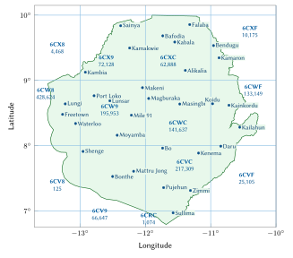
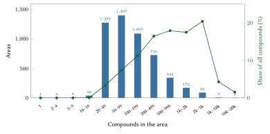
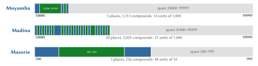
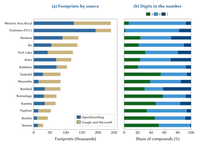

# Introduction

An address does three jobs. It lets a person say where they live in a form that someone else can act on; it lets an institution hold a stable reference to a place; and it lets a visitor, a courier or an ambulance crew find the door. In Sierra Leone none of these jobs is done by a national system. The Universal Postal Union's addressing sheet for the country shows no postcode [@upu2002], Sierra Leone Postal Services (SALPOST) publishes no postcode list, and street names with house numbers exist only in central Freetown and parts of the larger towns. Elsewhere a home is described ("Kissy Road, near the mosque, then ask"), and finding it depends on a telephone call and local knowledge.

The country has, however, one strong address practice. Freetown City Council (FCC) rebuilt its property register from satellite imagery after 2020, growing it from about 60,000 to more than 160,000 properties, and identifies each property by its Plus Code, an open grid reference, because "buildings do not always have a reliable street name nor a house number" [@fcc2024; @ataf2023]. Any national model has to respect that practice, and should be compatible with it.

This paper describes such a model and the register built with it. Our contributions are:

1. a code that people can say and remember, a place name they already use and a short number, which is nevertheless unique nationally on its own, without a district, chiefdom or town after it (Sections 4.1 to 4.8);
2. a numbering scheme that is local (neighbours receive neighbouring numbers), extensible (new homes and new places never renumber existing ones) and verifiable (a check digit catches every single-digit error and every transposition of neighbouring digits, including slips that would land in another place of the same name) (Sections 4.6 to 4.9);
3. full compatibility with Freetown City Council's Plus Code addresses, which are shown first in the council's area (Sections 4.10 and 4.13);
4. a complete, open register of 1,359,282 codes, a reference engine, and a deployable server that reproduces the national issuer's answers (Section 5); and
5. a measured evaluation and a set of explicit impact estimates for citizens, commerce, emergency services and government (Sections 6 to 11).

Section 2 reviews the country's existing systems and the international literature. Section 3 describes the data. Section 4 sets out the model, with every formula and a worked example on a real code. Section 5 covers the implementation and Section 6 its evaluation. Section 7 records the designs we considered and rejected. Sections 8 to 11 estimate the benefits by sector. Section 12 discusses privacy, safety and governance, Section 13 the limitations, and Section 14 concludes.

# Background and related work

## Addressing, postal and land systems in Sierra Leone

Sierra Leone covers about 71,740 km² on the Atlantic coast of West Africa. The provisional results of the 2021 Mid-Term Population and Housing Census counted 7,541,641 people, a figure that was publicly contested [@statssl2021]. English is the official language and Krio the language that almost everyone shares; Mende predominates in the south and east and Temne in the north and west, alongside Limba, Kono, Kissi, Fula, Susu and others. Digits are written the same way whatever language is spoken, and numbers are commonly said in Krio or English.

**No postcodes.** The UPU sheet, dated 07/2002, gives the example `Mr. John Kamara, 7A Ross Road Cline, FREETOWN` and no postcode [@upu2002]. We found no announcement of postcodes or of a national address system by SALPOST, the Ministry of Communication, Technology and Innovation or the National Civil Registration Authority up to October 2026 (the record is in `docs/existing-systems.md`).

**Freetown's Plus Codes.** FCC describes a Plus Code as "a unique eleven-character code that acts like a postal code and street address", and gives its own office at 17 Wallace Johnson Street as `FQR7+HX` [@fcc2024]. A points-based valuation piloted in the city in 2019 depended on exactly this kind of property identification [@grieco2019]. FCC's register is not open: it is a rates register, and its owners, valuations and payments are confidential.

**Boundaries in motion.** The 2017 reorganisation created the North West Province and the Falaba and Karene districts, and raised the number of chiefdoms from 149 to 190 [@africareview2017]. In 2025 the Minister of Local Government announced Cabinet approval for two further districts, Bandajuma and Kpanguma, and new councils for Freetown and the Western Area Rural district [@sierraloaded2025]. A code built on any administrative unit would have changed twice in a decade.

**Census and land.** The 2026 Population and Housing Census is scheduled to begin on 2 December 2026 [@statssl2026]; it will produce enumeration areas, not addresses. The National Land Commission Act 2022 creates a Cadastral Index Mapping Department, and the Customary Land Rights Act 2022 governs the registration and demarcation of customary land [@nlc2022; @clra2022]. Survey plans use the Sierra Leone 1968 datum projected to UTM zones 28N and 29N [@epsg2161]. An address is not a title, and the model keeps the two apart.

## International practice

The UPU's S42 standard defines the components of postal addresses and templates for rendering them [@upuS42], and ISO 19160-1 gives a conceptual model of address information, including the lifecycle of an address and its aliases [@iso19160]. Both describe how addresses are structured once they exist; neither says how to create them where they do not. The UPU's white paper on addressing argues that an address is a public good and a precondition of postal, financial and civic services [@upu2012].

The most systematic evidence on creating addresses in African cities comes from the World Bank's review of street-addressing programmes carried out between 1989 and 2004 in 52 cities of 15 countries [@farvacque2005]. In a sample of 21 cities that completed the work, 1.2 million doorways were addressed at an average cost of US\$5.7 per doorway, and before the programmes only 8% of streets had names. The review also stresses that an address directory is useful beyond the post, for example to reconcile tax rolls, and warns that without maintenance an address system quickly becomes obsolete, especially where the city keeps growing. That warning motivates two of our choices: to start from names that people already use, and to make the register extensible without ever renumbering it.

## Grid codes and why none fits alone

Open Location Code (Plus Codes) divides the globe into a hierarchical grid of base-20 cells [@olc]. A ten-character code names a cell of about 14 m by 14 m, and a code can be shortened by a nearby reference town. It is open, offline and already used by FCC. Its drawbacks as a home address are that it mixes letters with a "+", that people copy it rather than remember it, and that in a dense quarter one cell can contain several homes (Section 6 measures how often).

National grid addresses have been adopted in the region. Ghana's digital property addressing system, launched in 2017, assigns codes to cells of about 5 m by 5 m [@citifm2017]. Such schemes give every point a code but, like Plus Codes, the code is not something people already say.

Purely numeric national identifiers are easy to dial but carry no meaning; codes built on districts are easy to say but are invalidated by redistricting. Section 7 sets out these alternatives with measurements on the Sierra Leonean data.

## Requirements

From this review we derived ten requirements, in order of priority:

1. **Remembered without effort**: a place name people already use and a short number said in groups, obtained with one tap.
2. **Unique nationally on its own**: no district, chiefdom, town or phone position needed.
3. **The compound and its gate**: the unit is the plot or family yard; buildings are sub-units; navigation ends at the gate.
4. **Official addresses first**: where the state already addresses a property, its address is shown first, and every point is expressed on FCC's grid.
5. **No administrative boundary inside a code.**
6. **Works offline.**
7. **Stable**: a code is never moved and never reused.
8. **Places, never people.**
9. **Open and transferable** to the state.
10. **Sierra Leone's own**: the model and its engine are specific to the country.

# Data and sources

The register is built from four open sources (Table 1). Building footprints come from OpenStreetMap [@haklay2008; @geofabrik2026] and, where OpenStreetMap has none, from the machine-learned footprints of Google Open Buildings [@sirko2021] and Microsoft [@microsoft2023], distributed together by the Overture Maps Foundation [@overture2026]. Place names come from OpenStreetMap place nodes; district outlines come from geoBoundaries [@runfola2020]. Walls, fences and gates are taken from OpenStreetMap.

| Source | Content used | Licence | Count |
|:------------|:------------|:-------|--------:|
| OpenStreetMap (extract of 17 October 2026) | building outlines and tags | ODbL 1.0 | 831,055 footprints |
| Google Open Buildings and Microsoft, via Overture | footprints that OpenStreetMap lacks | CC BY 4.0 / ODbL | 784,646 footprints |
| OpenStreetMap place nodes | names of cities, towns, villages, quarters, hamlets | ODbL 1.0 | 9,316 places |
| OpenStreetMap barriers, N-Ways routing data | closed walls, fences and hedges; gates | ODbL 1.0 | 423 enclosures, 354 gates |
| geoBoundaries ADM2 | district outlines, used as labels only | CC BY 3.0 IGO | |

: Data sources of the register. {#tbl:sources}

Footprints and place nodes outside the national boundary (13,575 footprints in the extract) are dropped, so that no home across the border receives a Sierra Leonean code. The machine-learned footprints carry a height attribute, but it takes only 36 distinct values between 3.5 m and 7 m and is not used. Figure 1 shows the country, the 1° zones into which the registry is split, and the 31 reference towns used for short Plus Codes; Figure 4(a) shows the contribution of each source by district. OpenStreetMap supplies most footprints in Freetown, Kailahun, Kenema and Kono, where mapping projects have been active, and the machine-learned datasets supply most of them in Moyamba, Bonthe and Pujehun.

{#fig:zones width=78%}

# The model

This section defines the model step by step, in the order in which a code is built: its written forms, the areas, the plate names and name keys, the national ranges, the numbering, the check digit, the spot codes and the grouping of buildings into compounds. Each step is illustrated on the same real code, Moyamba 15727.

## The forms of a code

A compound's code exists in a small number of written forms (Table 2). Let $P$ be the plate name of the compound's area, $N$ its number (three to five digits, never starting with zero), $A$ the area's five-digit index, $F$ the four-digit national identifier of the name, and $g$ the position of the compound's gate. Then
$$
\text{remembered} = P \;\sqcup\; N, \qquad
\text{plate} = P \;\sqcup\; \gamma(N) \;\cdot\; \sigma(g), \qquad
\text{machine} = \texttt{SL-}A\texttt{-}N,
\tag{1}
$$
where $\sqcup$ denotes a space, $\gamma$ writes the number in the groups in which it is said ($482$; $27\,16$; $157\,27$), and $\sigma(g)$ is the short Plus Code of the gate (Section 4.10). The check digit $c = \operatorname{Damm}(F \,\|\, N)$ of Eq. (14) belongs to systems only: it is returned and verified by the interface, and never printed on a plate.

| Form | Example | Used by |
|:--------|:-------------|:-------------|
| Remembered | **Moyamba 15727**, said "Moyamba 157 27" | people: said, typed, written on a parcel |
| Plate | **Moyamba 157 27 · 5H68+3V Moyamba** | plates, stickers, forms, shared messages |
| Machine | **SL-03663-15727** | applications, QR codes, partner systems |
| Structure, unit | **Moyamba 15727.2**, **Moyamba 15727.2/3** | a building of the compound; a flat or shop let separately |
| Spot | **5H68+3V Moyamba**, `6CW95H68+3V` | any point: its Plus Code |
| Official address (FCC's area) | **FQQ6+9G Freetown** | FCC's property address, shown first |

: The forms of one code. {#tbl:forms}

## Areas

An area is a named place that people use, frozen at first issue, with no administrative parent. Its seed is an OpenStreetMap place node, either *primary* (city, town, suburb, quarter, village) or *secondary* (neighbourhood, hamlet, locality, isolated dwelling). Let $S_1$ and $S_2$ be the primary and secondary seeds and $d(f,s)$ the great-circle distance from footprint $f$ to seed $s$. Each footprint is assigned to
$$
\operatorname{area}(f) =
\begin{cases}
\arg\min_{s \in S_1} d(f,s) & \text{if } \min_{s \in S_1} d(f,s) \le 4\ \text{km},\\
\arg\min_{s \in S_2} d(f,s) & \text{else if } \min_{s \in S_2} d(f,s) \le 15\ \text{km},\\
\arg\min_{s \in S_1} d(f,s) & \text{otherwise.}
\end{cases}
\tag{2}
$$

Two corrections follow. A primary area whose estimated compound count exceeds 4,500 is *split*: a footprint moves to the nearest secondary seed within 3 km whose own nearest primary seed is that area, when that seed is nearer than the area's seed. An area with fewer than 20 compounds is *folded* into the area of the primary seed nearest its own seed, within 30 km. The estimate uses 0.779 compounds per footprint, the ratio measured in Freetown during the design. Areas never cross the Sierra Leone River estuary, so Lungi and the Bullom shore keep their own areas even where a Freetown seed is nearer across the water.

Of the 9,316 seeds, 5,184 areas hold homes (47 large areas were split and 1,466 small ones folded); 134 of them, with 192,608 compounds, lie in FCC's area. The median area holds 93 compounds, the 90th percentile 604 and the largest, Makeni, 10,639 (Figure 2).

{#fig:areasizes width=92%}

## Plate names

The name in a code must be short enough to say with a number and to paint on a gate. A plate name $s$ is accepted when
$$
\operatorname{ok}(s) \iff \lvert \operatorname{NFC}(s) \rvert \le 12 \;\wedge\; \lvert \operatorname{words}(s) \setminus L \rvert \le 2 \;\wedge\; s \text{ contains no digit},
\qquad L = \{\text{of}, \text{the}, \text{and}, \text{on}, \text{at}\},
\tag{3}
$$
where $\lvert\operatorname{NFC}(s)\rvert$ counts characters after Unicode normalisation (a hyphen or apostrophe counts as one). A name over the limit passes through fixed steps: a documented short form that people already use, if one exists (none has yet been documented for Sierra Leone); cleaning ("Community", "Comm", "Estate", "Area" and bracketed text dropped; "Town", "Village" and "Ville" dropped only at the end of a name still over the limit, because many names are said whole: Allen Town, Congo Town, Murray Town, and Kissy Town is not Kissy); a digit written as a word ("Badasuma 2" becomes Badasuma Two); and a landmark word (Junction, Wharf, Street, Corner, Quarry) dropped, so that Gbangbatoke Junction becomes **Gbangbatoke**. Nothing else is cut automatically. Where shortening would drop a place word or a person's name, lose a qualifier (Upper Komende, Magbesseh 1 and 2) or produce the name of another place or of a well-known town (Moyamba Junction is not Moyamba), the area is referred to its council with up to three candidates (Table 3).

| Outcome for the 5,184 areas | Areas |
|:--|--:|
| Plate name equal to the official name | 4,890 |
| Cleaned | 115 |
| Shortened by dropping a landmark word | 23 |
| Referred to the council with candidates | 156 |
| of which still over the limit | 42 |
| Official names longer than 12 characters | 235 |

: Plate-name outcomes. {#tbl:plates}

The 156 referred areas carry a provisional plate name, under which 84,311 codes were issued; a council may change such a name once, and the numbers do not change. The official name always remains an alias (208 aliases, none dropped), so that "Gbangbatoke Junction 1051" finds "Gbangbatoke 1051".

## The name key

Two areas share a national range when their plate names have the same *key*:
$$
\kappa(s) = \operatorname{join} \circ \operatorname{fold} \circ \operatorname{drop}_{\text{the}} \circ \operatorname{split} \circ \operatorname{punct} \circ \operatorname{casefold} \circ \operatorname{unaccent}\,(s).
\tag{4}
$$

The steps are listed in Table 4. The word folds reflect Krio and English spellings of the same word and the ways numbers are written.

| Step | Rule | Example |
|:-----|:---------------|:---------|
| unaccent, casefold | accents and case removed | FOURAH BAY → fourah bay |
| punct | apostrophes removed; `- _ . , / ( )` become spaces; `&` becomes "and" | Ma'Sorie → masorie |
| fold | tong → town, kru → kroo, saint → st, mount → mt, one…ten → 1…10, ii → 2, iii → 3 | Kissy Tong = Kissy Town |
| drop "the" | a leading "the" dropped | The Wharf → wharf |
| join | words joined, non-alphanumeric ones dropped | Gbangba Toke → gbangbatoke |

: The steps of the name key, Eq. (4). {#tbl:key}

The 5,184 areas carry 3,706 distinct plate names. Of these, 590 are shared, by 2,068 areas: Madina by 28 areas, Baoma by 24, Nyandehun and Sembehun by 23 each, and Moyamba and Looking Town by five each.

## One national range per name

A name whose range has $d$ digits owns the numbers $10^{d-1}$ to $10^{d}-1$, which we cut into 90 *units* of
$$
u(d) = 10^{\,d-2}
\tag{5}
$$
numbers each: 10 for three digits, 100 for four and 1,000 for five. Each place $i$ of the name, with $n_i$ compounds, receives a block of whole units holding twice its compounds,
$$
k_i(d) = \max\!\left(1, \left\lceil \frac{2\,n_i}{u(d)} \right\rceil\right),
\tag{6}
$$
and the name takes the smallest length that leaves at least nine units in reserve:
$$
d^{*} = \min \Big\{ d \in \{3,4,5\} \;:\; \textstyle\sum_i k_i(d) + 9 \le 90 \Big\}.
\tag{7}
$$

Blocks are laid out from $10^{d^*-1}$ upwards, in the order of the places' seeds along the national Hilbert curve of Section 4.6 (ties broken by area index); the rest of the range is the name's reserve. A block that fills, or a new place with the same name, takes the next whole units of the reserve. When the reserve runs out, the name opens a range one digit longer (numbers of different lengths never collide), up to five digits. Blocks never move, shrink or get renumbered.

**Worked example: Moyamba.** Five places share the name, with 698, 4,313, 241, 35 and 26 compounds. At four digits (units of 100), Eq. (6) gives $14 + 87 + 5 + 1 + 1 = 108$ units, more than the 81 available; at five digits (units of 1,000) it gives $2 + 9 + 1 + 1 + 1 = 14$ units, which fit (Table 5, Figure 3).

| Place | District | Compounds | Block |
|:--|:--|--:|:--|
| Moyamba | Moyamba | 698 | 10000–11999 |
| Moyamba (the town) | Moyamba | 4,313 | 12000–20999 |
| Moyamba | Bombali | 241 | 21000–21999 |
| Moyamba | Kenema | 35 | 22000–22999 |
| Moyamba | Kenema | 26 | 23000–23999 |
| reserve | | | 24000–99999 |

: The national range of the name Moyamba. {#tbl:moyamba}

**Worked example: Masorie.** Masorie Community in the Western Area Rural district (plate name Masorie, 48 compounds) and two villages called Masorie in Tonkolili (134 and 54 compounds) share a three-digit range: 100–199, 200–469 and 470–579. **Masorie 151** and **Masorie 315** are two places 42 km apart.

{#fig:ranges width=100%}

The resulting lengths are summarised in Table 6 and, by district, in Figure 4(b). The largest shared range is Kpetema's: seven places with 11,008 compounds, at five digits. No name needs more than five digits, so none needs a qualifier.

{#fig:districts width=86%}

| Digits | Names | Areas | Compounds | Share of compounds |
|:--|--:|--:|--:|--:|
| 3 | 2,945 | 3,387 | 346,381 | 25.5% |
| 4 | 720 | 1,569 | 788,449 | 58.0% |
| 5 | 41 | 228 | 224,452 | 16.5% |

: Length of the number, by name, area and compound. {#tbl:digits}

## Numbering within a place: the Hilbert curve

Compounds are numbered along one Hilbert curve [@hilbert1891] of order 16 over a fixed national frame, $\varphi \in [6.85^\circ, 10.05^\circ]$ N and $\lambda \in [-13.35^\circ, -10.20^\circ]$, evaluated at the centre of each compound's main building. The Hilbert curve preserves locality better than other common space-filling curves [@moon2001], so neighbours receive neighbouring numbers. The cell coordinates are
$$
x = \left\lfloor \frac{\lambda + 13.35}{3.15}\, 2^{16} \right\rfloor, \qquad
y = \left\lfloor \frac{\varphi - 6.85}{3.20}\, 2^{16} \right\rfloor ,
\tag{8}
$$
and the position $h$ along the curve is accumulated over the bits $s = 2^{15}, 2^{14}, \dots, 1$:
$$
\begin{aligned}
&r_x = [\,x \wedge s \neq 0\,], \qquad r_y = [\,y \wedge s \neq 0\,], \qquad h \leftarrow h + s^2\,\big((3 r_x) \oplus r_y\big),\\
&(x,y) \leftarrow
\begin{cases}
(s-1-y,\; s-1-x) & \text{if } r_y = 0 \text{ and } r_x = 1,\\
(y,\; x) & \text{if } r_y = 0 \text{ and } r_x = 0,\\
(x,\; y) & \text{if } r_y = 1,
\end{cases}
\end{aligned}
\tag{9}
$$
where $\wedge$ is bitwise conjunction, $\oplus$ exclusive or, and $[\cdot]$ the indicator. Figure 5 shows the curve of order 3. The $n$ compounds of a place with block $[\ell, u]$, sorted by $(h, \text{stable identifier})$ and indexed $i = 0, \dots, n-1$, receive
$$
N_i = \ell + i\,\delta + \left\lfloor \frac{\delta}{2} \right\rfloor, \qquad \delta = \left\lfloor \frac{u - \ell + 1}{n} \right\rfloor .
\tag{10}
$$

{#fig:hilbert width=52%}

**Worked example: Moyamba 15727.** The compound's main building lies at $\varphi = 8.1602399$, $\lambda = -12.4327947$. Eq. (8) gives $x = 19\,082$ and $y = 26\,833$, and Eq. (9) a curve position $h = 774\,683\,469$. Moyamba town's block is 12000–20999 for 4,313 compounds, so $\delta = \lfloor 9\,000 / 4\,313 \rfloor = 2$, and the compound is the one with index $i = 1\,863$ in curve order:
$$
N_{1863} = 12\,000 + 1\,863 \times 2 + \lfloor 2/2 \rfloor = 15\,727 .
\tag{11}
$$

Figure 6 shows the result over the whole town: numbers rise smoothly across quarters, and a person who knows one code can guess the neighbourhood of another.

{#fig:moyamba width=92%}

## New compounds

A new compound whose curve position lies between those of its issued neighbours $a$ (at or before it) and $b$ (after it) takes the free number nearest the midpoint, strictly between them:
$$
N_{\text{new}} = \arg\min_{\,a < m < b,\; m \text{ free}} \left| m - \left\lfloor \tfrac{a+b}{2} \right\rfloor \right| ,
\tag{12}
$$
with the edges of the block standing in for a missing neighbour. Because Eq. (10) leaves half of each block free, a gap normally exists; between Moyamba 15725 and 15727 a new house receives **15726**. A full block takes a further block from the name's reserve (Section 4.5). A point within 3 m of an issued entrance or outline, or inside an outline, is not issued a new code; the existing one is returned.

## Decoding without context

The trailing digits of a written code are the number, whether typed in groups or not. A final single digit after a grouped number, if a system sends one, is the check digit. The name key gives the national range and the number gives the one block that holds it:
$$
\operatorname{decode}(P, N) = \big\{\, p \;:\; \kappa(P) \in \{\kappa(p)\} \cup \operatorname{aliases}(p),\;\; N \in \operatorname{blocks}(p) \,\big\}.
\tag{13}
$$

By construction the set has at most one element. A number in no block, or in a name's reserve, is answered "no such address" and is never guessed into a nearby place. An official name that ends in a number ("Mile 91 1001") is also tried with the number as part of the name, every split being tried, longest number first.

## The check digit

The check digit uses Damm's algorithm [@damm2004; @damm2007], which, like Verhoeff's earlier dihedral-group scheme [@verhoeff1969], detects every single-digit error and every transposition of adjacent digits, but needs only one table lookup per digit. For the digit string $F \,\|\, N = t_1 t_2 \dots t_m$,
$$
c_0 = 0, \qquad c_k = T[c_{k-1}][t_k] \quad (k = 1, \dots, m), \qquad c = c_m,
\tag{14}
$$
where $T$ is the table of a totally anti-symmetric quasigroup of order 10:
$$
T = \left[\begin{array}{cccccccccc}
0&3&1&7&5&9&8&6&4&2\\ 7&0&9&2&1&5&4&8&6&3\\ 4&2&0&6&8&7&1&3&5&9\\ 1&7&5&0&9&8&3&4&2&6\\ 6&1&2&3&0&4&5&9&7&8\\
3&6&7&4&2&0&9&5&8&1\\ 5&8&6&9&7&2&0&1&3&4\\ 8&9&4&5&3&6&2&0&1&7\\ 9&4&3&8&6&1&7&2&0&5\\ 2&5&8&1&4&3&6&7&9&0
\end{array}\right].
\tag{15}
$$

**Worked example.** The name Moyamba has the national identifier $F = 2674$. For Moyamba 15727 the digits $2,6,7,4,1,5,7,2,7$ give the running values
$$
(c_1, \dots, c_9) = (1, 4, 9, 4, 1, 5, 5, 7, 0), \qquad c = 0 .
\tag{16}
$$

The transposition 15772 gives check 7, and the single error 15737 gives check 9. Because every place of a name shares the name's identifier, Damm's guarantee holds across them: a slip that lands in another Moyamba's block is also caught (Section 6.4). The check digit is for systems: the interface returns it and verifies it when a system sends it, but it is never printed on a plate and people never type it.

## Spot codes: Open Location Code

A spot code is the point's Plus Code, exactly as the specification and FCC use it [@olc]. Five pairs of base-20 digits from the alphabet `23456789CFGHJMPQRVWX` encode, pair by pair, a latitude digit and a longitude digit at resolutions $\rho_j = 20^{\circ}, 1^{\circ}, 0.05^{\circ}, 0.0025^{\circ}, 0.000125^{\circ}$. With $\Phi_0 = \varphi + 90$ and $\Lambda_0 = \lambda + 180$,
$$
a_j = \left\lfloor \frac{\Phi_{j-1}}{\rho_j} \right\rfloor,\quad
b_j = \left\lfloor \frac{\Lambda_{j-1}}{\rho_j} \right\rfloor,\quad
\Phi_j = \Phi_{j-1} - a_j \rho_j,\quad
\Lambda_j = \Lambda_{j-1} - b_j \rho_j, \qquad j = 1, \dots, 5,
\tag{17}
$$
and the code is the sequence of characters $\alpha(a_1)\alpha(b_1)\dots\alpha(a_5)\alpha(b_5)$ with a "+" after the eighth, where $\alpha(k)$ is the character of index $k$ in the alphabet, counted from zero.

**Worked example.** For Moyamba 15727, $\Phi_0 = 98.1602399$ and $\Lambda_0 = 167.5672053$ (Table 7). The full code is `6CW95H68+3V`, a cell of about 14 m by 14 m; an eleventh character (`6CW95H68+3VW`) narrows it to about 3 m.

| Resolution | Latitude digit $a_j$ | Longitude digit $b_j$ | Characters |
|:--|--:|--:|:--|
| 20° | 4 | 8 | 6 C |
| 1° | 18 | 7 | W 9 |
| 0.05° | 3 | 11 | 5 H |
| 0.0025° | 4 | 6 | 6 8 |
| 0.000125° | 1 | 17 | 3 V |

: The Plus Code of Moyamba 15727, Eq. (17). {#tbl:olc}

The code is written short against one of 31 fixed reference towns, dropping its first four characters when the point lies within 0.4° of the town on both axes: `5H68+3V Moyamba`. Recovery prefixes the town's own first four characters and moves by one degree if the result lies more than half a degree from the town, the Open Location Code rule, so recovery is exact within 0.5°; the margin of 0.1° tolerates another application placing the town slightly differently. FCC's office, `FQR7+HX`, recovers against Freetown to `6CW8FQR7+HX`: the engine and FCC use the same code. Figure 7 shows one ten-character cell subdivided into its 400 eleventh-level cells, with the compounds whose entrances lie in it.

{#fig:spot width=80%}

## Compounds: grouping structures

The registry groups footprints into compounds before any number is given, one area at a time, after sorting them by stable identifier. Let $\operatorname{dist}(a,b)$ be the shortest distance between the outlines of footprints $a$ and $b$ (zero if one touches or overlaps the other), $|a|$ the area of $a$, and $\eta(a)$ the number of footprints in its 100 m × 100 m cell. A *satellite* $a$ ($|a| < 30$ m²) joins the nearest *principal* $b$ ($|b| \ge 30$ m² and $|b| \ge 2|a|$) when
$$
\operatorname{dist}(a,b) \le r(\eta(a)), \qquad
r(\eta) =
\begin{cases}
8\ \text{m} & \eta \le 25 \ \text{(village yard)},\\
4\ \text{m} & 25 < \eta \le 70 \ \text{(town)},\\
\text{no grouping} & \eta > 70 \ \text{(dense)}.
\end{cases}
\tag{18}
$$

Before this rule, a footprint whose centre lies inside a mapped closed wall, fence or hedge (40 m² to 20,000 m²) belongs to that enclosure's compound, and estates, government, military and police compounds become parents whose inner compounds keep their own codes (Table 8). Only satellites join, and only principals receive them, so two houses are never merged. In Kroo Bay, Susan's Bay and the slopes above Kissy there are no walls and yards are shared; merging there would send people to the wrong door, so the dense rule groups nothing.

| Rule | Condition | Effect |
|:---|:-------------|:----------|
| Wall | centre inside a mapped closed wall, fence or hedge (40–20,000 m²) | the enclosure is one compound |
| Estate | inside an estate, government, military or police compound | a parent; inner compounds keep their own codes |
| Dense | more than 70 footprints in its 100 m cell | no grouping; each footprint is a compound |
| Yard | at most 25 footprints in its cell; a satellite | joins a principal within 8 m |
| Town | otherwise, a satellite | joins a principal within 4 m |
| Single | anything else | its own compound |

: Grouping rules, Eq. (18). {#tbl:rules}

**Results.** The 1,615,701 footprints form 1,359,282 compounds, 1.19 footprints per compound: 1,097,084 single buildings, 137,580 village yards, 70,435 town joins, 53,834 compounds in dense cells and 349 from mapped walls. 1,151,027 compounds have one structure, 169,990 two, 30,855 three and 7,410 four or more. With the 2021 census count, a compound holds on average about 5.5 people. Table 9 gives the figures by district.

| District | Compounds | Footprints | Median footprint (m²) |
|:--|--:|--:|--:|
| Freetown (FCC's area) | 192,608 | 240,866 | 45.8 |
| Western Area Rural | 194,276 | 240,079 | 56.2 |
| Kenema | 116,440 | 138,987 | 58.5 |
| Bo | 114,723 | 135,990 | 70.4 |
| Port Loko | 104,942 | 122,264 | 76.6 |
| Kono | 101,386 | 116,971 | 56.9 |
| Kailahun | 85,415 | 103,520 | 48.7 |
| Tonkolili | 73,558 | 83,429 | 74.9 |
| Moyamba | 71,868 | 83,473 | 57.0 |
| Bombali | 70,389 | 83,198 | 83.2 |
| Koinadugu | 63,101 | 70,887 | 48.2 |
| Kambia | 57,968 | 68,211 | 74.7 |
| Pujehun | 46,339 | 53,792 | 56.3 |
| Bonthe | 40,068 | 43,970 | 64.6 |
| Karene | 25,864 | 29,678 | 71.3 |
| Outside the district outlines | 337 | 386 | |

: Compounds and footprints by district. {#tbl:district}

**Validation.** We re-ran the rules on the 240 walls and fences in OpenStreetMap that enclose two or more buildings, with the walls hidden from the rules. 9.6% of the enclosures came out whole and 9.2% exactly, and a further 36.2% missed only one building. Inside a Freetown wall the buildings often stand apart while neighbours across the wall stand close, so proximity alone cannot recover walled compounds. The rules are deliberately cautious: merging two codes later costs nothing, whereas splitting a wrong merge would give a family a new code.

## The building profile

Every structure carries a use class with its confidence and source, its size, its floors where known, and a status. The Sierra Leonean taxonomy includes block houses, *pan body* houses (Krio *pan bodi*, corrugated iron), mud houses, round huts, storey buildings, shops, markets, offices, schools, health facilities, places of worship, industry and mining, ancillary buildings and buildings under construction. Classes are inferred in a fixed order: OpenStreetMap amenity, shop, office or tourism tags (confidence 0.85); the building type (0.8 to 0.85, with the material for pan-body and mud houses); an N-Ways place inside (0.7, or 0.6 for two or more); the material alone (0.6); a very small (under 6 m², ancillary) or very large (at least 2,000 m², warehouse) footprint (0.35); otherwise *unknown* (Table 10).

| Class | Structures |
|:--|--:|
| unknown | 1,552,224 |
| house | 30,106 |
| ancillary | 10,308 |
| under construction | 9,891 |
| round hut | 5,889 |
| school | 1,321 |
| shop | 1,271 |
| health | 998 |
| worship | 759 |

: The most frequent use classes. {#tbl:classes}

96% of structures are unknown until people confirm them, because 94% of the country's OpenStreetMap buildings carry only `building=yes`. OpenStreetMap gives floors for 1,120 buildings. A home never carries a name.

## Freetown: the council's Plus Code first

In FCC's area (134 areas, 192,608 compounds) every card and plate shows the property's Plus Code first, as FCC's address ("FQQ6+9G Freetown"); the N-Ways code follows, to be said aloud and to distinguish the buildings of one property. The Plus Code shown is that of the compound's main building, which is how FCC addresses properties. Where FCC's register records a different code for a property, FCC's code replaces it. FCC's property identifiers are never shown publicly. If SALPOST, the Ministry or the National Land Commission introduces an official address elsewhere, the same rule applies: it comes first in its area, and the N-Ways codes remain valid beside it.

# Implementation

**Reference engine.** `engine/reference/sl_address.py` implements every rule of Section 4 with the Python standard library: parsing, the name key, ranges and blocks, the Hilbert numbering, Damm's check, Open Location Code encoding, shortening and recovery, plate names and compound grouping. The specification (`engine/SPEC.md`) is normative, and two files of conformance vectors (`engine/reference/test_vectors.json` and `engine/reference/vectors.json`) fix the expected outputs: 522 name keys, 400 forms, 1,321 decodings, 400 spot codes, numbering, block sizes and grouping cases. Any other implementation must reproduce them.

**Registry.** `registry/` holds every issued code, one gzip-compressed CSV file per 1° zone (13 files, Figure 1), the frozen area table `areas.csv`, and `MANIFEST.json`, which records the count per zone and the SHA-256 of every file. Each row carries the machine, remembered and written forms, the area, district, number and check digit, the status (all codes are *provisional* until residents confirm them), the entrance point and its kind, the Plus Code, FCC's address where it applies, and a building summary (class, use, kind, number of structures, floor area and grouping rule). `engine/data/register.json` is what a decoder needs: the reference towns and every area with its plate name, official name, name key, national identifier and blocks, and no data about any home.

**Server and interface.** `server/` is a deployable service built on the Python standard library and SQLite. `python3 -m server import` streams the registry into a database, verifying every file's hash and count against the manifest and refusing any mismatch; `export` writes the registry back, and an export after an import is byte-identical to the published files. A JSON interface under `/v1` serves the full card of a code, search by remembered form, machine form, official address or Plus Code, the compound at or near a point, verification of a machine code, spot codes, zones and areas. Issuing (`POST /v1/codes`) and status changes (`PATCH`) require a bearer key and apply the national issuer's rules unchanged; a deployment without keys is read-only. `docs/api.md` lists every endpoint with a real request and response, and `server/openapi.yaml` gives the formal schema. A Docker image imports the bundled registry on first start, so that one command deploys it.

**Parity with the national issuer.** The server's tests replay 32 issuing steps and 7 block-allocation cases computed by the national issuer's own implementation, including a door, an eleventh compound that forces a new block, points in Freetown and a point outside the country. On the full registry the import took 17 s and produced a database of 640 MB; 50 randomly chosen codes compared field by field (25 fields each) with the national service gave no mismatch in 1,250 comparisons.

**One issuer.** Numbers are unique because one register decides them. Only the deployment designated by the State, or by N-WAYS LIMITED until the State designates another, issues codes; every other deployment runs read-only. Two issuers would hand out the same number twice.

# Evaluation

All figures in this section are computed from the published files by `tools/paper-evaluation.py` and recorded in `model/stats/evaluation.json`; Table 11 summarises them.

| Property | Measure | Result |
|:-----|:---------------|:--------|
| Coverage | compounds with a code | 1,359,282 (100%) |
| Uniqueness | duplicate machine forms; duplicate remembered forms (by name key) | 0; 0 |
| Decoding | written forms that decode to their own machine form | 1,359,282 of 1,359,282 |
| Number length | compounds with 3 / 4 / 5 digits | 25.5% / 58.0% / 16.5% |
| Code length | characters of the remembered form: median, 90th percentile, maximum | 12, 16, 28 |
| Plate names | compounds whose plate name meets Eq. (3) | 1,327,645 (97.7%) |
| Check digit | cross-place slips accepted (Section 6.4) | 0 of 653,805 |
| Plus Code cells | compounds sharing their 10-character cell with another compound | 259,143 (19.1%) |
| Grouping | walled enclosures recovered whole / exactly / missing one building | 9.6% / 9.2% / 36.2% |

: Measured properties of the issued register. {#tbl:eval}

## Uniqueness and decoding

Every one of the 1,359,282 machine forms occurs once, and no two compounds share a remembered form once names are compared by their key, Eq. (4). Decoding the written form of every code, exactly as printed on its plate, returns its own machine form in every case. The test suite of the reference engine also checks the frozen register for overlapping blocks and for any number that would decode to two areas; there are none.

## Length

The number has three digits for a quarter of compounds and four for well over half. The remembered form, name and number together, has a median length of 12 characters and a 90th percentile of 16; 94.3% of codes have at most 16 characters. The longest codes belong to the 42 areas whose provisional names still exceed the limit (31,637 compounds, 2.3%); once their councils choose short names, no code will exceed 18 characters (a twelve-character name, a space and five digits, as in Looking Town 13316).

## Coverage and official addresses

Every compound in the footprint data has a code. 192,608 compounds (14.2%) lie in FCC's area, where the council's Plus Code is the official address and is shown first; for the remaining 1,166,674 (85.8%) the N-Ways code is the only address at door level.

## Slips across places of one name

The danger peculiar to shared ranges is a typing slip that lands in the block of another place with the same name. We sampled 40 numbers in every block of every shared name and formed every single-digit substitution and every transposition of neighbouring digits that stays within the name's range and falls in another place's block: 653,805 such slips. With the check computed over the name's identifier and the number, Eq. (14), none is accepted, as Damm's theorem guarantees. Had the check been computed over the area's own identifier instead, the receiving system would compute the check for a different payload, and 71,342 of the slips (10.9%, about one in nine) would have been accepted.

## Plus Code cells

Of the 1,359,282 compound entrances, 259,143 (19.1%) share their ten-character Plus Code cell with at least one other compound. A ten-character Plus Code therefore cannot serve as a home address on its own in Sierra Leone: in nearly one case in five it names more than one home. This is the main quantitative reason for printing the Plus Code under the name and number rather than in their place.

## Worked examples

Table 12 lists real codes from the register: the compound nearest each of several well-known places.

| Near | Code | Plate | Machine form | Official address |
|:--------|:--------|:--------|:-------|:----------|
| Moyamba town | **Moyamba 15727** | Moyamba 157 27 | SL-03663-15727 | |
| Connaught Hospital, Freetown | **Connaught 2301** | Connaught 23 01 | SL-00623-2301 | FQQ6+9G Freetown |
| FCC, Wallace Johnson Street | **Government Wharf 1755** | Government Wharf 17 55 | SL-01297-1755 | FQQ7+2P Freetown |
| Kroo Bay | **Kroobay 3435** | Kroobay 34 35 | SL-02177-3435 | FQP5+QC Freetown |
| Hill Station | **Hill Top 1067** | Hill Top 10 67 | SL-01359-1067 | FQ53+X6 Freetown |
| Waterloo | **Waterloo 3429** | Waterloo 34 29 | SL-04954-3429 | |
| Makeni | **Makeni 13893** | Makeni 138 93 | SL-02750-13893 | |
| Koidu Government Hospital | **Koidu 16247** | Koidu 162 47 | SL-01925-16247 | |
| Kabala | **Kabala 12041** | Kabala 120 41 | SL-01485-12041 | |

: Real codes from the register. {#tbl:examples}

A rider who is told "Moyamba, one five seven, two seven" types `moyamba 157 27` and is shown one compound, in Moyamba District, with its gate. `moyamba 22014` lies in the block 22000–22999 of a Moyamba in Kenema District: there is no list to choose from and nothing to guess. A partner system that sends `Moyamba 157 72` with check 0 is refused, because the check of `267415772` is 7.

# Designs considered and rejected

Table 13 lists the main alternatives and the measurements that decided between them.

| Option | Example | Measurement | Decision |
|:--------|:------|:-------------|:------|
| Short Plus Code as the code | 5H68+3V Moyamba | six symbols with letters and a "+"; 19.1% of compounds share a cell | printed on the plate, not the code |
| Plus Code block and serial | 5H59-G2V Moyamba | seven symbols with letters; the block means nothing to people | rejected |
| National digits | 2051271 | seven digits needed for 1.36 million compounds with room to grow; no meaning | rejected |
| District key and number | MOY 15727 | districts redrawn in 2017 and again approved in 2025 | rejected |
| Full official names | Connaught Hospital Community 2301 | 235 official names exceed 12 characters; the longest code had 33 characters | plate names, Eq. (3) |
| One range per area, names repeated | Moyamba 1572 | not unique: 590 names are shared by 2,068 areas | rejected |
| Context (phone position) to separate same-named places | | a code must mean the same wherever it is said | rejected |
| Check over the area's identifier | | 10.9% of cross-place slips accepted | rejected |
| **Name and number, one national range per name** | **Moyamba 157 27** | unique; median 12 characters | **adopted** |

: Designs considered. {#tbl:designs}

**The cost of shared ranges.** Sharing a range lengthens some numbers: a hamlet that shares a large town's name takes a five-digit block. On the design-stage areas outside FCC's area (1,088,783 compounds), numbering each area on its own would have given three digits to 43% of compounds, four to 50% and five to 7%; with shared ranges the shares were 31%, 55% and 14%. In exchange, no code needs anything but its place and its number.

**Why a digit, and why Damm's.** A check character that detects all single errors and all adjacent transpositions needs either an eleventh symbol with a prime modulus, as in the ISBN-10, or a quasigroup scheme such as Verhoeff's or Damm's [@verhoeff1969; @damm2007]. Digits read the same in Krio, English, Mende and Temne; an "X" would not. Damm's scheme needs no separate permutation table. The name's identifier, rather than the area's, goes into the payload, which keeps the guarantee across every place of a name (Section 6.4).

**Choices made during issue.** Three choices were made on the final data. Every compound is numbered, Freetown included, with FCC's Plus Code shown first, because a code that can be said is as useful in Freetown as anywhere and FCC's code remains the official address. Blocks were sized from the compounds actually grouped (1,359,282) rather than from the design estimate of 0.779 compounds per footprint. And the grouping was made independent of the order of the input data: the issuer numbered all 1,359,282 compounds with its own implementation and refused any difference from the reference engine before writing a single code.

# Benefits for citizens

For a family in Kroo Bay, in a village yard in Kono or in a new house in Waterloo, a code changes four ordinary things.

**Being found.** Today a visitor or a rider is guided by telephone, landmark by landmark. With a code, a person says one short phrase and the application leads to the gate.

**Proving where one lives.** Banks, mobile-money agents, schools and employers ask for an address that can be checked. Outside central Freetown almost nobody can give one.

**Receiving goods and services.** Families abroad, shops and utilities can send to a code instead of a description, and a household can ask for a connection or a repair at the right gate.

**At no cost.** Nothing is asked of the household: every compound already on the map had its code from 20 October 2026, and the code is free, needs no document and holds no personal data. It is not a land title.

**Estimate.** Let $C$ be the number of compounds coded, $p$ the mean number of people per compound, and $\theta$ the share of compounds that had an official address before. The number of people who gain a verifiable address at door level is
$$
B = (1 - \theta)\, C\, p .
\tag{19}
$$

With $C = 1\,359\,282$ and $\theta = 0.142$ (FCC's area, Section 6.3), the central value $p = 5.5$ (the 2021 census count divided by $C$) gives $B \approx 6.4$ million people. Because the provisional census figures were contested [@statssl2021], we vary $p$ between 5.0 and 6.0, which gives 5.8 to 7.0 million. The estimate counts coverage, not use: Section 13 sets out how use will be measured.

**Who benefits most.** Those with the least today: families in Freetown's dense shore and hillside settlements, villages far from any landmark, mining towns that grow faster than any map, and anyone for whom a place they know and a number are easier than letters.

# Logistics and commerce

Delivery in Sierra Leone runs on the telephone. Practitioners report first-attempt delivery rates as low as 60% for many African courier companies, with errors in communicating addresses a recurrent cause, and an average cost of about US\$2.70 per last-mile delivery attempt [@odeloye2023].

**What the code gives a business.** A stable key for every customer (the machine form); routing to the gate, or to the main building until the gate is confirmed; checked input, since a system can send the check digit with a code; and open access, since the registry and engine can be used offline in the business's own systems without payment. Every code also carries its gate's Plus Code, readable by any Plus Code application and by FCC. Markets such as Big Market and Dove Cot, the rural *lumas*, and the ferry and water-taxi crossings to Lungi can send goods and payments to a compound by code; mining towns such as Koidu, Tongo, Lunsar and Marampa receive codes for new compounds as they appear (Section 4.7).

**Estimate.** Let $V$ be the number of deliveries, $f$ the share of first attempts that fail, $\alpha$ the share of those failures that a precise, checked address would avoid, and $c$ the cost of an attempt. The saving is
$$
S = V\, f\, \alpha\, c .
\tag{20}
$$

Per 1,000 deliveries, with $c = \text{US}\$2.70$ and central values $f = 0.20$ and $\alpha = 0.5$, $S \approx \text{US}\$270$. The parameter $f$ ranges from 0.10 to the reported upper bound of 0.40, and $\alpha$ is an assumption that we vary from 0.25 to 0.75 (Table 14). None of these values has yet been measured in Sierra Leone.

| | $\alpha = 0.25$ | $\alpha = 0.50$ | $\alpha = 0.75$ |
|:--|--:|--:|--:|
| $f = 0.10$ | US\$68 | US\$135 | US\$203 |
| $f = 0.20$ | US\$135 | US\$270 | US\$405 |
| $f = 0.40$ | US\$270 | US\$540 | US\$810 |

: Saving per 1,000 deliveries, Eq. (20), with a cost of US\$2.70 per attempt. {#tbl:delivery}

# Emergency services

An ambulance, fire crew or police patrol faces the courier's problem with more at stake. Sierra Leone's National Emergency Medical Service became operational nationwide on 27 May 2019; by the end of March 2020 its 81 ambulances had handled 36,814 emergency calls and 35,493 missions [@ragazzoni2021]. A countrywide study of 6,387 obstetric referrals found that the risk of maternal death rose with prehospital time, from 1.8% at 60 minutes to 3.8% at 120 minutes, and that the two-hour benchmark was met by more than 90% of referrals in Freetown but by fewer than 40% in some rural districts [@caviglia2021]. A qualitative study of an emergency medical service elsewhere in Africa found that crews and dispatchers lost time locating patients because they depended on local knowledge and needed several calls to pass a location [@hunt2023]. We know of no published measurement of locating time in Sierra Leone, which is itself a reason to begin one.

**How a code helps a dispatcher.** The caller says one phrase: "Masorie, three one five". The registry returns one compound in Tonkolili, not Masorie Community in the Western Area. The dispatcher reads back the place, its district and its gate; the crew drives to the gate; and a Plus Code marks any point with no compound, such as a crash on a highway. All of this works offline.

**Estimate.** For out-of-hospital cardiac arrest, Larsen and colleagues modelled survival as 67% less 2.3 points per minute before cardiopulmonary resuscitation, 1.1 points per minute before defibrillation and 2.1 points per minute before advanced care [@larsen1993]. Where one crew brings all three, a delay of $\Delta t$ minutes in finding the gate costs
$$
\Delta S = (2.3 + 1.1 + 2.1)\,\Delta t = 5.5\,\Delta t \ \text{percentage points of survival}.
\tag{21}
$$

For obstetric emergencies the countrywide study implies an increase in maternal mortality of about $\beta = (3.8 - 1.8)/60 \approx 0.033$ percentage points per minute between one and two hours. For $M$ missions to homes, the deaths averted by saving $\Delta t$ minutes are
$$
D = M\, \Delta t\, \beta .
\tag{22}
$$

Table 15 gives both quantities for savings of 2, 5 and 10 minutes. The cardiac model was fitted to an urban system with short response times, and the obstetric slope is an observational association; both indicate the value of a minute rather than predict outcomes in Sierra Leone.

| Minutes saved $\Delta t$ | Cardiac arrest, $\Delta S$ (points), Eq. (21) | Maternal deaths averted per 1,000 obstetric missions, Eq. (22) |
|:----|------:|------:|
| 2 | 11 | 0.7 |
| 5 | 27.5 | 1.7 |
| 10 | 55 | 3.3 |

: Value of locating time saved. {#tbl:emergency}

# Government coordination and planning

A code is a shared key. When ministries, councils, utilities and Statistics Sierra Leone refer to a compound by the same code, their records can be joined without matching names and descriptions.

**One reference for all services.** An address directory gives a list of premises more complete than a tax roll and reveals who is missing from it [@farvacque2005]. In Freetown the registry and FCC's register share the Plus Code grid, so the two can be compared building by building. As a first cross-check, FCC reports more than 160,000 properties [@fcc2024] and the registry counts 192,608 compounds in the council's area, a ratio of about 0.83. The units differ (FCC counts rateable properties and excludes impermanent structures, while the registry counts compounds), but the two counts are of the same order, which suggests that neither misses a large part of the city.

**A code that outlives reforms.** Districts and chiefdoms are labels looked up from a compound's position. When the districts approved in 2025 come into force, every code keeps working and shows its new district.

**The census.** A table of codes against the 2026 census's enumeration areas would give the census a frame of 1,359,282 compounds to sample from and return to, and give the registry household counts, without storing any name.

**Access to services.** Straight-line distances from a random sample of 20,000 compounds to the nearest mapped facility show what can be planned with the registry (Table 16). These figures describe the map as much as the country: schools, police posts and pharmacies outside the towns are thinly mapped. A ministry can replace the facility list with its own and recompute the table in minutes.

| Facility | Mapped facilities | Within 2 km | Within 5 km | Median distance |
|:-------|-----:|-----:|-----:|-----:|
| Health facility | 1,473 | 61.8% | 89.3% | 1.2 km |
| School | 936 | 46.7% | 55.9% | 2.9 km |
| Police | 63 | 27.6% | 41.2% | 11.1 km |
| Pharmacy | 160 | 19.8% | 28.2% | 18.4 km |

: Straight-line distance from 20,000 random compounds to the nearest mapped facility. {#tbl:access}

**Estimate.** The World Bank's programmes cost US\$5.7 per doorway addressed on average (prices of 1989 to 2004) [@farvacque2005]; a programme in one country that also included tax surveys cost US\$7.6 per doorway. A door-numbering survey of the same coverage would therefore have cost
$$
K = C\, k, \qquad C = 1\,359\,282,\quad k \in [5.7,\ 7.6]\ \text{US\$} \;\Rightarrow\; K \approx 7.7 \text{ to } 10.3 \text{ million US\$},
\tag{23}
$$
at the prices of that period. The comparison is not exact: those programmes also named streets and installed signs, which the code does not replace, while the code adds gates, structures and a national register that a survey does not produce.

# Privacy, safety and governance

**Places, never people.** Codes describe places: homes carry no names and no occupant data, and businesses and public buildings carry only their public names. Photographs submitted with a new home are kept for verification only, and a household can ask for its gate to be hidden, in which case its code resolves to the area rather than the gate. FCC's rates data never enters the registry.

**Data protection.** Sierra Leone has no data protection law in force. Cabinet approved a National Data Protection Policy in April 2026 and authorised a Data Protection and Right to Access Information Act [@moice2026dp], following the national validation of the bill in November 2025 [@moice2025bill]. Until the law is in force the registry follows the ECOWAS Supplementary Act on personal data protection [@ecowas2010], and the issuer will register with the authority once it is established.

**Governance.** A single issuer maintains the register, so that no two homes share a code. Reference towns are fixed and may only be added; areas and blocks are frozen; codes are never moved and never reused, and regrouping never changes an issued code. A council may rename an area (the old name remains an alias), choose a provisional short name once, or add areas. FCC's Plus Codes are the address in its area, and its property identifiers remain FCC's. If an official address or postcode is introduced, it comes first in its area. The repository, the registry and the rules can be transferred to the State, to FCC, to SALPOST, to Statistics Sierra Leone or to a body they name, under the open licences, without forking the engine.

**Confirmation.** Every code starts as provisional and becomes confirmed when residents agree in the application: two telephones, at least one at the gate, with most answers concurring. No code is reviewed by hand.

# Limitations and future work

- **The area list rests on OpenStreetMap place points**, whose coverage is uneven; names and spellings need confirmation by residents and councils.
- **156 plate names are provisional**, 42 of them still over the limit, until councils choose.
- **Compounds are inferred.** Few walls are mapped, so most compounds are single buildings or joined by proximity, and the validation in Section 4.11 shows that walled compounds are often split.
- **Uses are mostly unknown** (96%), and floors almost always.
- **Gates are almost unknown**: most codes lead to the main building until gates are confirmed.
- **FCC's register is not open.** Until FCC shares its address fields, the Plus Code shown first is that of the compound's main building.
- **The impact estimates are not measurements.** Table 17 lists what we will measure.
- **Codes are unique within Sierra Leone only**; the application shows the country on every card.

| Measure | Method | Target |
|:-----------|:-------------|:------|
| Own code recalled after a week | residents asked without the application, in Krio, Mende and Temne | at least 80% exact |
| First-attempt delivery success | partner couriers, with and without a code | at least 20 points higher |
| Time from the community to the gate | courier application timestamps | halved |
| Gates confirmed | residents and couriers | 10,000 |
| Locating time for emergency calls | with the National Emergency Medical Service, if it takes part | measured, then halved |

: Measurements planned. {#tbl:measure}

# Conclusion

Sierra Leone can have a national address without first naming its streets or freezing its administrative map. A place name that people already use, followed by a short number from a national range for that name, is unique on its own, short (a median of twelve characters) and robust to typing errors when transmitted with a Damm check digit. It coexists with Freetown City Council's Plus Codes, which remain the official address in the city, and with any official system introduced later. The register of 1,359,282 codes, the reference engine and a deployable server are open, so that any ministry, council or company can resolve codes and obtain the same answers as the national issuer. The next steps are the councils' choice of the provisional names, the confirmation of gates with residents and couriers, and the measurements of Table 17.

# Data and code availability {-}

The specification, reference engine, conformance vectors, registry, server and the sources of this paper are available at <https://github.com/n-ways/open-addresses-sierra-leone> [@nways2026]. Code is licensed under the Apache License 2.0, data under the Open Database Licence 1.0 and documents under CC BY 4.0. Every use should be credited as "N-Ways Addressing for Sierra Leone, © N-WAYS LIMITED (nways.ng)", with a link to the repository. The figures of this paper are computed by `tools/paper-figures.py` and `tools/paper-evaluation.py` from the published files.

# Acknowledgements {-}

The register is derived from OpenStreetMap (© OpenStreetMap contributors, ODbL), Google Open Buildings (CC BY 4.0) and Microsoft's building footprints (ODbL), distributed by the Overture Maps Foundation, and from geoBoundaries. We thank the many mappers whose work on Sierra Leone made it possible, and Freetown City Council, whose published account of its property reform informed the treatment of Freetown.

# References {-}

::: {#refs}
:::
